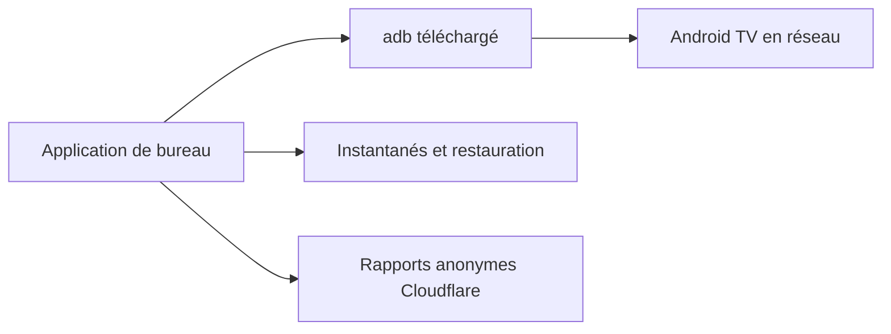

# bryanroscoe/shield_optimizer

> A desktop application to slim down and tune an Android TV via ADB, for example an Nvidia Shield.

## The problem
Android TV boxes ship with useless apps, and the useful settings are buried or require ADB command lines.

## What it actually does
The application downloads its own `adb`, discovers TVs on the network and offers tabs: health, app disabling with a protection list, launcher change, HDMI-CEC and frame rate, remote control, files, APK installation, restorable snapshots and an ADB shell. The old PowerShell scripts are kept as the v1 version.

## How it is wired
Simplified diagram based on the card, no diagram provided.



## Trying it
```bash
brew tap bryanroscoe/shield-optimizer
brew install --cask atv-optimizer
```

## Cost and gotchas
Free. Builds are unsigned. Anonymous device and error reports are sent by default (can be disabled under "Report a bug"). Amazon Fire TV is not supported.

## What it is not
Not a risk-free tool: the Shell tab runs any command. An ADB bug on macOS with a Shield Pro is reported in version 2.4.1. The license is present but unidentified.

## Alternatives
No alternative named in the README.

## For you
Ignore: it tunes a TV box, outside your data and AI scope, and the telemetry enabled by default adds to an unidentified license.
