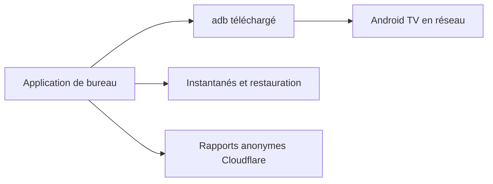

# bryanroscoe/shield_optimizer

> Une application de bureau pour alléger et régler une Android TV via ADB, par exemple une Nvidia Shield.

## Le problème
Les boîtiers Android TV embarquent des applications inutiles, et les réglages utiles sont enfouis ou demandent des lignes ADB.

## Ce que ça fait vraiment
L'application télécharge son propre `adb`, découvre les TV du réseau et propose des onglets : santé, désactivation d'apps avec liste de protection, changement de lanceur, HDMI-CEC et fréquence d'image, télécommande, fichiers, installation d'APK, instantanés restaurables et shell ADB. Les anciens scripts PowerShell sont conservés comme version v1.

## Comment c'est branché
Schéma simplifié d'après la fiche, sans diagramme fourni.



## Essayer
```bash
brew tap bryanroscoe/shield-optimizer
brew install --cask atv-optimizer
```

## Coût et pièges
Gratuit. Les builds ne sont pas signés. Des rapports anonymes d'appareil et d'erreur sont envoyés par défaut (désactivables dans « Report a bug »). Amazon Fire TV n'est pas supporté.

## Ce que ce n'est pas
Pas un outil sans risque : l'onglet Shell exécute n'importe quelle commande. Un bug ADB sur macOS avec une Shield Pro est signalé dans la version 2.4.1. La licence est présente mais non identifiée.

## Alternatives
Aucune alternative nommée dans le README.

## Pour toi
À ignorer : cela règle un boîtier TV, hors de ton périmètre data et IA, et la télémétrie activée par défaut s'ajoute à une licence non identifiée.

