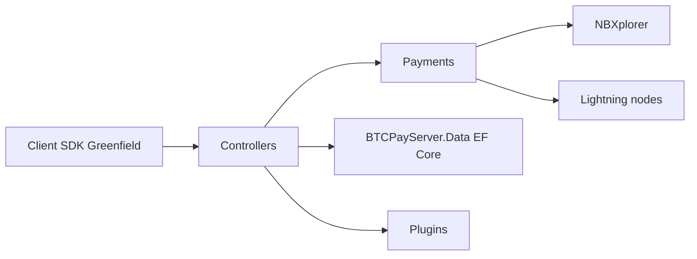

# btcpayserver/btcpayserver

> Self-hosted Bitcoin payment processor for merchants, with no fees and no intermediary.

## The problem
Accepting Bitcoin without going through a third party that takes fees and holds the funds.

## What it actually does
ASP.NET Core application: MVC UI, Greenfield API, BitPay-compatible API. Stores are the tenant boundary; on-chain, Lightning, LNURL and PayJoin payments. Depends on NBXplorer and Lightning nodes (LND, Core Lightning, Eclair). EF Core persistence, extensibility through plugins.

## How it is wired

## Trying it
README has no command: it points to the documentation for users, operators and developers. Not documented here.

## Cost and gotchas
Free, but you operate the Bitcoin node, NBXplorer and backups; handling funds demands strict security discipline.

## What it is not
Not an exchange nor a hosted wallet. No analytics tool.

## Alternatives
No alternative named in the README.

## For you
Ignore: Bitcoin payments, unrelated to data/AI/MLOps.
