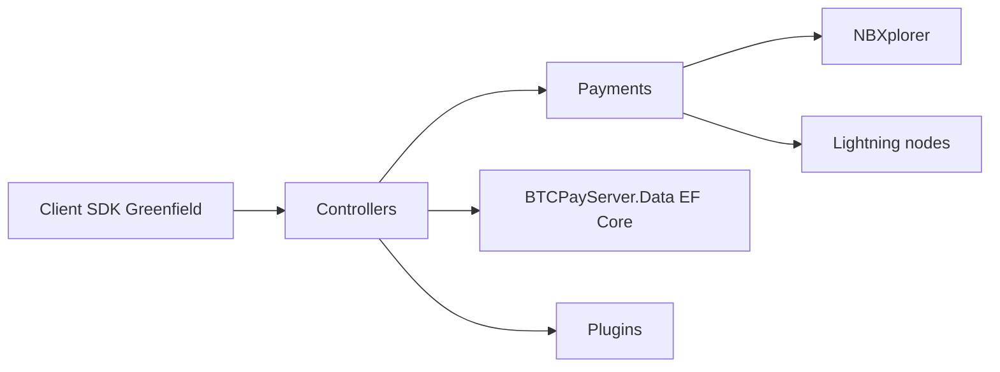

# btcpayserver/btcpayserver

> Processeur de paiements Bitcoin auto-hébergé, sans frais ni intermédiaire, pour commerçants.

## Le problème
Accepter du Bitcoin sans passer par un tiers qui prélève des frais et détient les fonds.

## Ce que ça fait vraiment
Application ASP.NET Core : UI MVC, API Greenfield, API compatible BitPay. Les boutiques sont le périmètre de tenant ; paiements on-chain, Lightning, LNURL, PayJoin. Dépend de NBXplorer et de nœuds Lightning (LND, Core Lightning, Eclair). Persistance EF Core, extensibilité par plugins.

## Comment c'est branché

## Essayer
README sans commande : renvoie à la documentation pour utilisateurs, opérateurs et développeurs. Non documenté ici.

## Coût et pièges
Gratuit, mais tu opères nœud Bitcoin, NBXplorer et sauvegardes ; manipuler des fonds impose rigueur de sécurité.

## Ce que ce n'est pas
Pas une place d'échange ni un portefeuille hébergé. Pas d'outil d'analyse.

## Alternatives
Aucune alternative nommée dans le README.

## Pour toi
À ignorer : paiement Bitcoin sans lien avec data/IA/MLOps.

