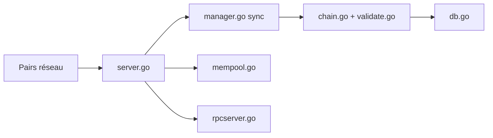

# btcsuite/btcd

> Bitcoin full node written in Go, without a wallet, to validate and relay the chain.

## The problem
Running a Bitcoin node is not limited to Bitcoin Core; an independent, modular implementation is needed to integrate chain validation into other programs.

## What it actually does
Downloads, validates and serves the chain under the same consensus rules as Bitcoin Core, relays blocks and transactions, maintains a transaction pool. Exposes a JSON-RPC server, a chain indexer and a CPU miner. No wallet: it is provided by btcwallet and Paymetheus.

## How it is wired


## Trying it
```bash
go version
go install -v . ./cmd/...
./btcd
```

## Cost and gotchas
Free. Requires Go 1.25 or later (README); the full chain takes up disk space and bandwidth (not quantified in the README). Prerequisite: a Go toolchain, not Python.

## What it is not
Not a wallet: you cannot send or receive payments directly. The README calls it beta, while also saying it has been stable since 2013.

## Alternatives
Bitcoin Core: the reference whose consensus rules btcd follows.

## For you
Ignore: a Bitcoin node in Go has no use for a data/AI/MLOps profile, except for a specific blockchain project.
