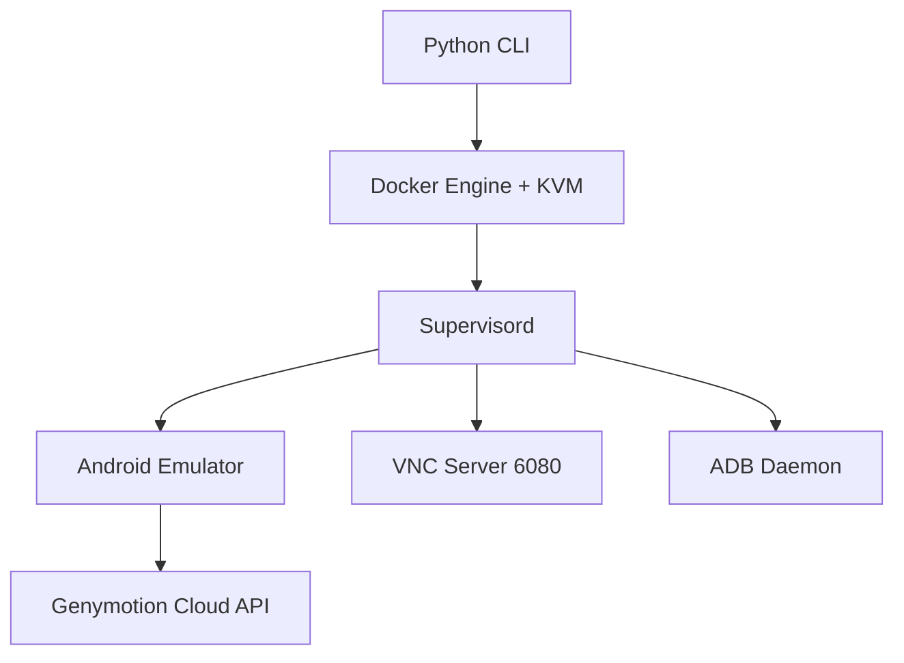

# budtmo/docker-android

> Docker images of Android emulators, with VNC and ADB, for testing and CI.

## The problem
Running a reproducible Android emulator in a CI, without a developer workstation, is painful.

## What it actually does
Images `emulator_9.0` to `14.0` with device profiles (Galaxy, Nexus, Pixel C).
Web VNC on port 6080, ADB reachable from outside, logs in a web interface, persistence through a volume.
It lets you run Appium and Espresso tests and integrates with Genymotion Cloud.
A Python CLI orchestrates everything under supervisord. MCP server and AI agent in beta.

## How it is wired


## Trying it
```bash
sudo apt install cpu-checker
kvm-ok
docker run -d -p 6080:6080 -e EMULATOR_DEVICE="Samsung Galaxy S10" -e WEB_VNC=true --device /dev/kvm --name android-container budtmo/docker-android:emulator_11.0
docker exec -it android-container cat device_status
```

## Cost and gotchas
KVM is required, so Ubuntu or a Linux VM. Android 15 and later, headless mode and the AI agent are reserved for the Pro version, available to sponsors. The regular version includes user-behavior analytics.

## What it is not
Not a farm of real devices. It does not run natively on macOS or Windows.

## Alternatives
The README names no alternative repository.

## For you
Ignore: it is mobile testing tooling, far from your data/AI topics.
