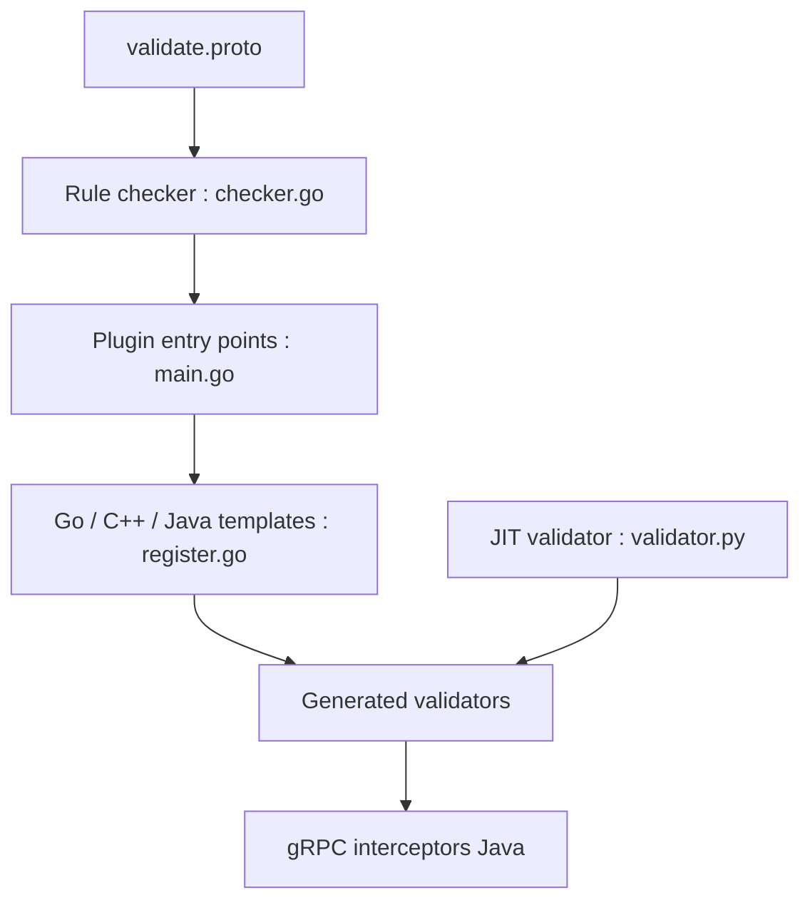

# bufbuild/protoc-gen-validate

> protoc plugin that generates protobuf message validators from rules written in the proto files.

## The problem
Protobuf guarantees types, not semantic rules (valid email, value range).

## What it actually does
You annotate fields with `(validate.rules)`. The plugin generates `Validate()` and `ValidateAll()` methods in Go, partially in C++, Java code with gRPC interceptors, and Python through runtime generation. It checks that rules do not contradict each other. Only proto3 is supported.

## How it is wired


## Trying it
```bash
git clone https://github.com/bufbuild/protoc-gen-validate.git
cd protoc-gen-validate && make build
protoc -I . -I path/to/validate/ --go_out=":../generated" --validate_out="lang=go:../generated" example.proto
```

## Cost and gotchas
Free. Repository archived, in maintenance mode. The Go module keeps the `envoyproxy` path, deliberately.

## What it is not
Not the recommended choice for a new project: the README recommends `protovalidate`.

## Alternatives
- protovalidate: successor recommended by the authors, with a migration guide.

## For you
Ignore for new work: archived, replaced by protovalidate; keep it only on existing code that depends on it.
