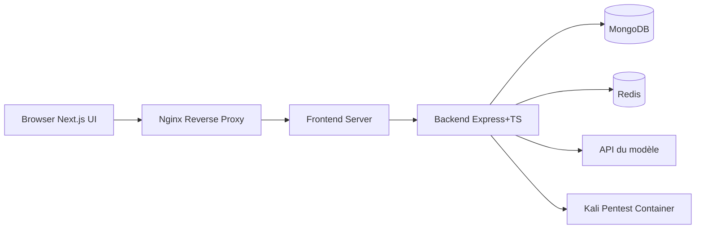

# bugbasesecurity/pentest-copilot

> Open source AI agent that drives a Kali machine to assist authorized penetration tests, for pentesters and CTF players.

## The problem
A penetration test chains many commands, output readings and tools to install. The repetitive work slows down the analysis.

## What it actually does
- An agent loop (up to 25 iterations per turn) runs commands on a Kali machine, reads the outputs and decides what comes next.
- 16 agent tools: shell, Python scripts, tool installation, web search, sub-agents, Burp Suite, automated browsing.
- Model of your choice: OpenAI, Anthropic, Google, Mistral, an OpenAI-compatible endpoint, or an already authenticated Codex / Claude Code CLI.
- Dangerous commands require explicit approval; local MCP access is offered.

## How it is wired


## Trying it
```bash
git clone https://github.com/bugbasesecurity/pentest-copilot.git
cd pentest-copilot
./run.sh start
# puis http://localhost:3000, Settings -> Models
./run.sh stop
```

## Cost and gotchas
A model provider API key is at your expense (or a local Codex / Claude Code subscription). 8 GB of RAM minimum, +2 GB with the Kali container, 20 GB of disk. The MCP token is equivalent to local administrator access.

## What it is not
Not a tool to point at a system without authorization: the README limits use to authorized tests. Not a service to expose as is: ports are bound to 127.0.0.1, with no TLS or authentication provided for an open network. On Windows, WSL2 is mandatory.

## Alternatives
No alternative named in the README.

## For you
Worth watching: interesting to see how an LLM agent orchestrates tools with human consent, but only useful if you have a legal audit framework or a CTF lab.
