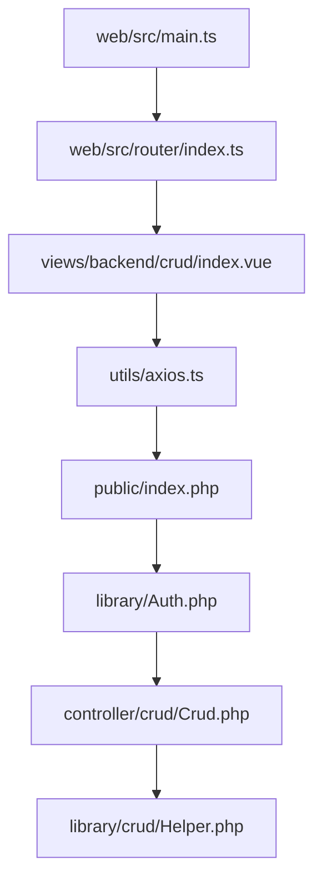

# build-admin/buildadmin

> Back-office skeleton built on Vue 3 and ThinkPHP 8 with CRUD code generation, for web developers.

## The problem
Building an administration panel (permissions, tables, forms) means rewriting the same screens over and over.

## What it actually does
An administration system using Vue 3, TypeScript, Vite, Pinia and Element Plus on a ThinkPHP 8 backend. It generates CRUD pages by drag and drop, and includes a web terminal, a module marketplace, a global recycle bin, tree-based permission management and a memory-resident mode via Workerman. The Apache-2.0 license allows commercial use. The README is in Chinese.

## How it is wired

## Trying it
No command is documented in the README: installation points to the online documentation (doc.buildadmin.com).

## Cost and gotchas
Free. The real requirements are PHP 8, a database and Node, none detailed in the README. Documentation and community are mostly in Chinese.

## What it is not
It is not a data or AI tool: it is a general-purpose back-office framework. The memory-resident mode goes through a separate Workerman module.

## Alternatives
No alternative named in the README (it cites FastAdmin and vue-next-admin as sources of inspiration).

## For you
Ignore: a PHP and Vue back-office, documented in Chinese, brings nothing to a data/AI/MLOps profile, unless you occasionally need an admin interface.
