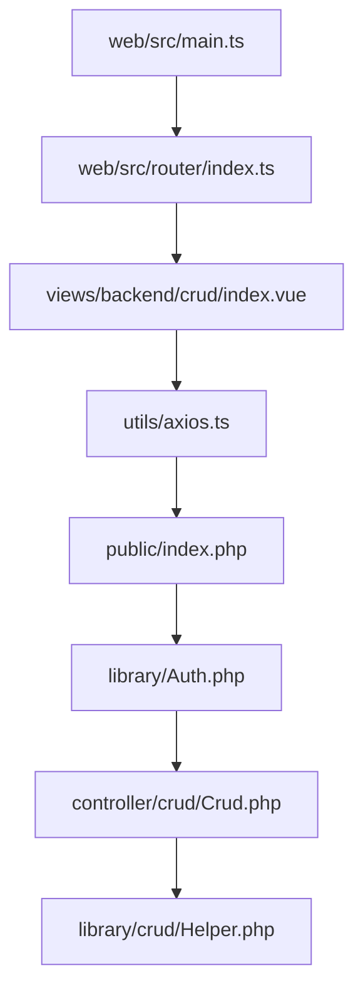

# build-admin/buildadmin

> Squelette de back-office Vue 3 et ThinkPHP 8 avec génération de code CRUD, pour développeurs web.

## Le problème
Monter un panneau d'administration (droits, tables, formulaires) demande de réécrire toujours les mêmes écrans.

## Ce que ça fait vraiment
Un système d'administration Vue 3, TypeScript, Vite, Pinia et Element Plus sur un backend ThinkPHP 8. Il génère des pages CRUD par glisser-déposer, intègre un terminal web, un marché de modules, une corbeille globale, la gestion de droits en arbre et un mode résident en mémoire via Workerman. La licence Apache-2.0 autorise l'usage commercial. Le README est en chinois.

## Comment c'est branché

## Essayer
Aucune commande documentée dans le README : l'installation renvoie à la documentation en ligne (doc.buildadmin.com).

## Coût et pièges
Gratuit. Le besoin réel est PHP 8, une base de données et Node, non détaillés dans le README. Documentation et communauté surtout en chinois.

## Ce que ce n'est pas
Ce n'est pas un outil de data ou d'IA : c'est un cadre de back-office généraliste. Le mode résident en mémoire passe par un module Workerman à part.

## Alternatives
Aucune alternative nommée dans le README (il cite FastAdmin et vue-next-admin comme sources d'inspiration).

## Pour toi
À ignorer : un back-office PHP et Vue, documenté en chinois, n'apporte rien à un profil data/IA/MLOps, sauf besoin ponctuel d'interface d'administration.

