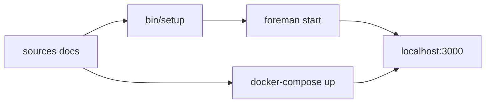

# buildkite/docs

> Source files of the official Buildkite documentation, for anyone who wants to fix or extend it.

## The problem
Product documentation needs an open repository, reproducible locally, to accept external contributions.

## What it actually does
Contains the source files of the Buildkite documentation site. Two development modes: without a container (Ruby, Node.js and Yarn, versions in `mise.toml`) or with Docker Compose. The local server listens on port 3000 and refreshes page by page.

## How it is wired


## Trying it
```bash
git clone git@github.com:buildkite/docs.git
cd docs
git submodule update --init
bin/setup
foreman start
# ou
docker-compose up --build
```

## Cost and gotchas
Free. Without Docker, you need Ruby, Node.js, Yarn and, on macOS, the Xcode command line tools. Adding a page requires restarting the server.

## What it is not
It is not a CI tool: it is the documentation for one. It does not contain the Buildkite product.

## Alternatives
No alternative named in the README.

## For you
Ignore: only useful if you contribute to Buildkite's docs; to learn the tool, read the published site.
