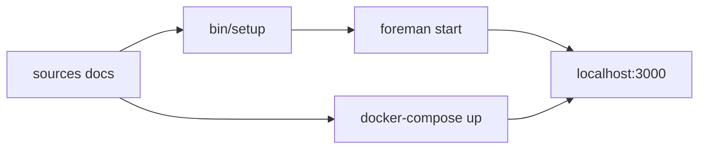

# buildkite/docs

> Sources de la documentation officielle de Buildkite, pour qui veut la corriger ou la compléter.

## Le problème
Une documentation produit a besoin d'un dépôt ouvert, reproductible en local, pour accepter des contributions externes.

## Ce que ça fait vraiment
Contient les fichiers sources du site de documentation Buildkite. Deux modes de développement : sans conteneur (Ruby, Node.js et Yarn, versions dans `mise.toml`) ou avec Docker Compose. Le serveur local écoute sur le port 3000 et se rafraîchit page par page.

## Comment c'est branché


## Essayer
```bash
git clone git@github.com:buildkite/docs.git
cd docs
git submodule update --init
bin/setup
foreman start
# ou
docker-compose up --build
```

## Coût et pièges
Gratuit. Sans Docker, il faut Ruby, Node.js, Yarn et, sur macOS, les outils de ligne de commande Xcode. Ajouter une page demande de relancer le serveur.

## Ce que ce n'est pas
Ce n'est pas un outil de CI : c'est la documentation de celui-ci. Elle ne contient pas le produit Buildkite.

## Alternatives
Aucune alternative nommée dans le README.

## Pour toi
À ignorer : utile seulement si tu contribues à la doc de Buildkite ; pour apprendre l'outil, lis le site publié.

