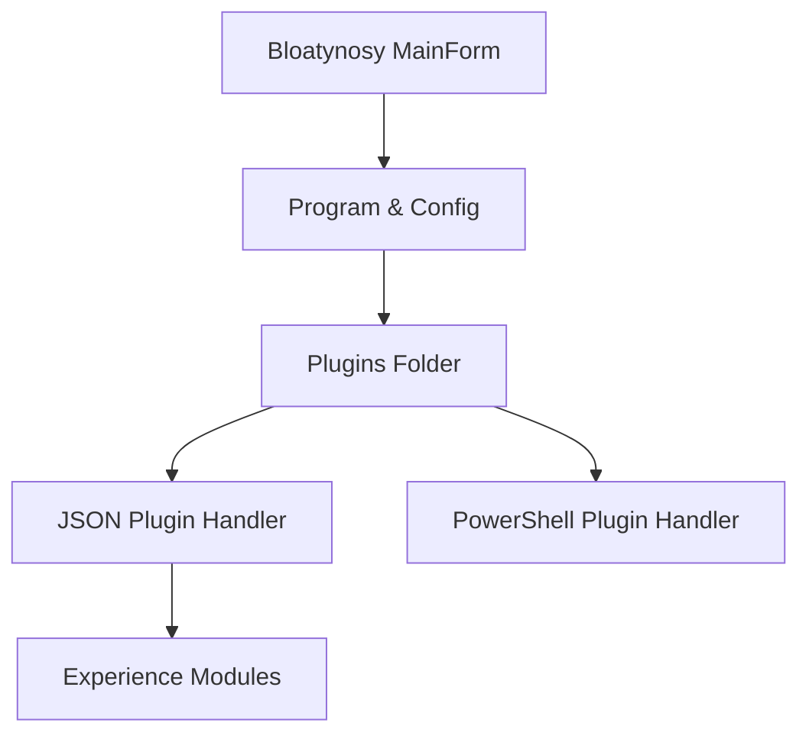

# builtbybel/Bloatynosy

> Portable Windows utility to see and choose the settings and apps to remove.

## The problem
Windows enables ads, suggestions and preinstalled apps that are hard to spot and to turn off one by one.

## What it actually does
Three steps: scan the PC, tick the changes, apply with a report. Each setting writes a documented registry value, read before and after. Store apps are removed with Remove-AppxPackage, classic programs with their uninstaller. Rules live in Data/WinRules.ini; neighbouring .ini files act as plugins, and profiles are JSON. Optional AI explanations.

## How it is wired

## Trying it
No command: download from the Releases page, extract, run Bloatynosy.exe (Windows 10 or 11, .NET Framework 4.8).

## Cost and gotchas
Free. Some settings require administrator rights. An AI provider API key is only needed for "Explain". App uninstalls are not reversible.

## What it is not
Not an automatic tool to run without reading: nothing is ticked for apps. The README describes a still-young project whose settings may not all stick.

## Alternatives
No alternative named in the README.

## For you
Ignore: Windows workstation cleanup, unrelated to data, AI or MLOps work.
