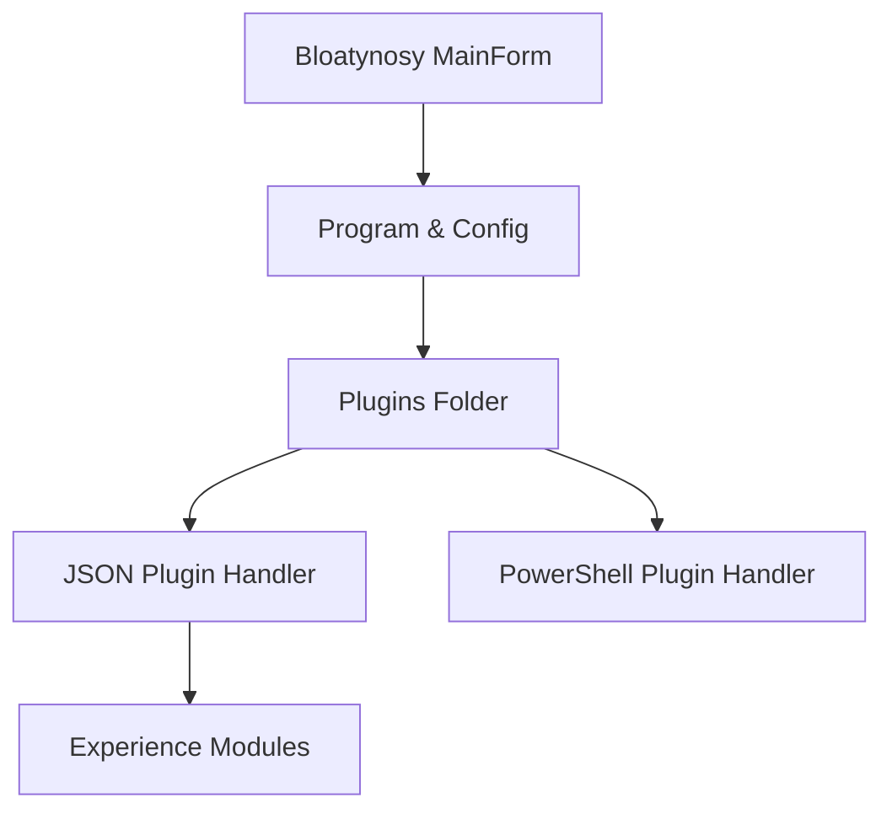

# builtbybel/Bloatynosy

> Utilitaire Windows portable pour voir et choisir les réglages et applications à retirer.

## Le problème
Windows active publicités, suggestions et applications préinstallées, difficiles à repérer et à désactiver un par un.

## Ce que ça fait vraiment
Trois étapes : vérifier le PC, cocher les changements, appliquer avec un rapport. Chaque réglage écrit une valeur de registre documentée, lue avant et après. Les applications Store partent par Remove-AppxPackage, les programmes classiques par leur désinstalleur. Règles dans Data/WinRules.ini ; les .ini voisins servent de greffons, les profils sont en JSON. Explications IA optionnelles.

## Comment c'est branché

## Essayer
Aucune commande : télécharger depuis la page Releases, extraire, lancer Bloatynosy.exe (Windows 10 ou 11, .NET Framework 4.8).

## Coût et pièges
Gratuit. Certains réglages exigent les droits administrateur. La clé d'API d'un fournisseur IA n'est nécessaire que pour « Explain ». Les désinstallations d'applications ne sont pas réversibles.

## Ce que ce n'est pas
Pas un outil automatique sans lecture : rien n'est coché pour les applications. Le README parle d'un projet encore jeune dont certains réglages peuvent ne pas tenir.

## Alternatives
Aucune alternative nommée dans le README.

## Pour toi
À ignorer : nettoyage de poste Windows, sans rapport avec un travail data, IA ou MLOps.

