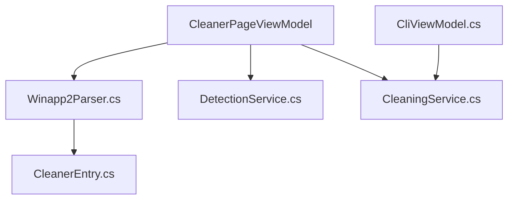

# builtbybel/FluentCleaner

> Minimalist Windows cleaner that reads winapp2.ini rules, with no ads and no fake registry cleaning.

## The problem
CCleaner-style cleaners have become loaded with ads and useless features; you want to clear caches and temporary files with readable rules.

## What it actually does
Parses community winapp2.ini rules, detects installed apps, lets you pick rules, then scans and deletes. Two editions: WinUI 3 (.NET 10, about 140 MB) and Classic (WinForms, about 3.5 MB). Adds custom rules, cookie management, AppX app removal, AI explanations and an `/AUTO` command line.

## How it is wired


## Trying it
```powershell
winget install --id Builtbybel.FluentCleaner --exact
FluentCleaner.exe /AUTO
```

## Cost and gotchas
Free. The modern edition requires the exact Windows App SDK 2.0.1 runtime, installed separately. It deletes files: a backup is advised. The README warns about a fake site, `fluentcleaner.org`: download only from GitHub.

## What it is not
Not a guaranteed PC accelerator nor a registry cleaner (deliberate omission). No secure multi-pass erasure. How the "AI explanations" work is not detailed in the README.

## Alternatives
BleachBit, cited in the README as using its own variants of winapp2.ini (the author finds its interface poor).

## For you
Ignore: consumer Windows utility, outside the data/AI/MLOps scope.
