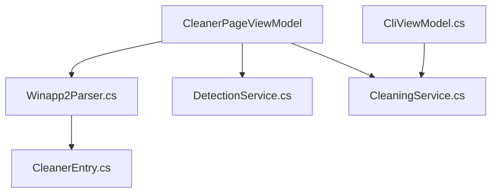

# builtbybel/FluentCleaner

> Nettoyeur Windows minimaliste qui lit les règles winapp2.ini, sans publicité ni faux nettoyage du registre.

## Le problème
Les nettoyeurs de type CCleaner se sont chargés de publicité et de fonctions inutiles ; on veut vider caches et fichiers temporaires avec des règles lisibles.

## Ce que ça fait vraiment
Parse les règles winapp2.ini (communauté), détecte les applis installées, laisse choisir les règles, analyse puis supprime. Deux éditions : WinUI 3 (.NET 10, environ 140 Mo) et Classic (WinForms, environ 3,5 Mo). Ajoute règles personnalisées, gestion de cookies, retrait d'applis AppX, explications par IA et une ligne de commande `/AUTO`.

## Comment c'est branché


## Essayer
```powershell
winget install --id Builtbybel.FluentCleaner --exact
FluentCleaner.exe /AUTO
```

## Coût et pièges
Gratuit. L'édition moderne exige le runtime Windows App SDK 2.0.1 exact, installé à part. Il supprime des fichiers : sauvegarde conseillée. Le README signale un faux site, `fluentcleaner.org` : ne télécharger que depuis GitHub.

## Ce que ce n'est pas
Pas un accélérateur de PC garanti ni un nettoyeur de registre (omission volontaire). Pas d'effacement sécurisé multi-passes. Le fonctionnement des « explications par IA » n'est pas détaillé dans le README.

## Alternatives
BleachBit, cité dans le README comme utilisant ses propres variantes de winapp2.ini (l'auteur juge son interface mauvaise).

## Pour toi
Ignorer : utilitaire Windows grand public, hors périmètre data/IA/MLOps.

