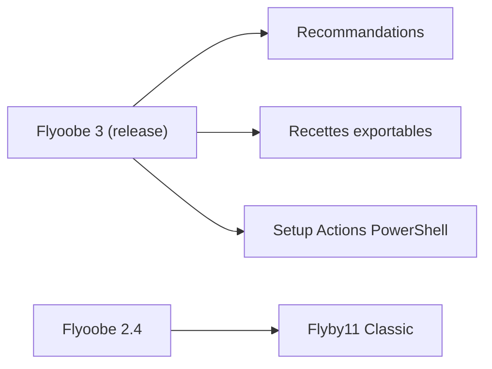

# builtbybel/FlyOOBE

> Windows assistant to install, clean up and configure the system, with upgrade to Windows 11.

## The problem
Windows defaults and preinstalled apps don't suit everyone; installing Windows 11 on hardware deemed ineligible is blocked.

## What it actually does
Flyoobe 3 compares the PC against file-based recommendations, lets you set up accounts, network, browsers and updates, remove preinstalled apps after confirmation, export "recipes" and add Setup Actions (PowerShell jobs, disabled by default). Flyby11 remains the old Windows 10 to 11 upgrade tool. The visible source code is the previous generation; 3.x is not yet published.

## How it is wired


## Trying it
No command: download from `github.com/builtbybel/Flyoobe`. For Actions:
```bash
# Extraire le dossier Actions de la release dans Data\Actions\<nom>\action.ini
# puis Settings > Advanced > activer Setup Actions
```

## Cost and gotchas
Free. Fake sites (`flyoobe.com`, account `github.com/flyoobe`) impersonate the project: only download from the official repo. Read each PowerShell action before running it.

## What it is not
Not a fully open source tool at this point: the 3.x sources are announced, not published. Flyby11 is no longer maintained.

## Alternatives
None cited in the README.

## For you
Ignore: a Windows workstation configuration tool, unrelated to data/AI/MLOps work.
