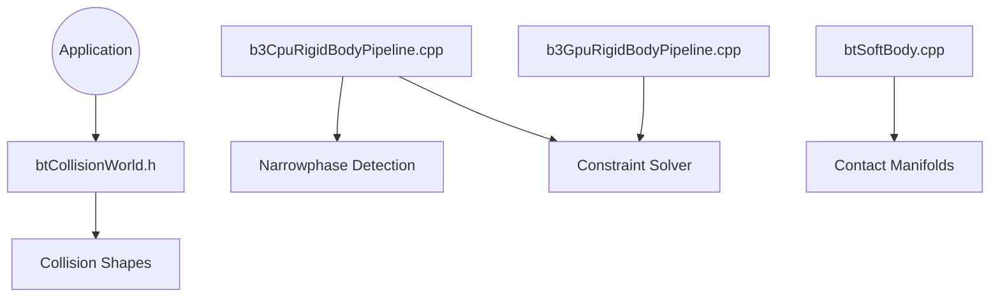

# bulletphysics/bullet3

> C++ real-time collision and physics engine, with Python bindings (PyBullet) for robotics and RL.

## The problem
Simulating rigid bodies, collisions and contacts requires a reliable physics engine. Rewriting one is slow and bug-prone.

## What it actually does
Collision detection (broadphase, narrowphase), constraint solver, rigid-body dynamics on CPU, with an optional OpenCL path. Adds soft bodies, a character controller and serialization. The README recommends PyBullet for robotics, reinforcement learning and VR. The issue tracker is closed to support questions.

## How it is wired


## Trying it
```bash
pip3 install pybullet --upgrade --user
python3 -m pybullet_envs.examples.enjoy_TF_AntBulletEnv_v0_2017may
python3 -m pybullet_envs.deep_mimic.testrl --arg_file run_humanoid3d_backflip_args.txt
```

## Cost and gotchas
Free. Building from source requires cmake or premake, and PyBullet must be built with cmake on Linux. The README examples date from 2017.

## What it is not
Not a game engine or a turnkey simulator: it is a low-level library. Support goes through the PyBullet forums, not through issues. The license is not identified by GitHub.

## Alternatives
- vcpkg (`vcpkg install bullet3`): install the C++ port without building by hand.

## For you
Adopt via `pip install pybullet` if you do robotics or RL in simulation, but check the license before any commercial use.
