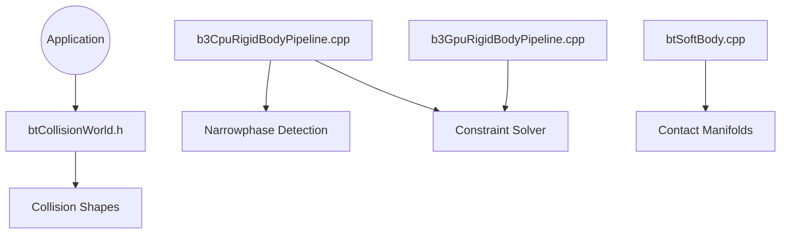

# bulletphysics/bullet3

> Moteur C++ de collisions et de physique temps réel, avec bindings Python (PyBullet) pour robotique et RL.

## Le problème
Simuler des corps rigides, des collisions et des contacts demande un moteur physique fiable. Le réécrire est long et source de bugs.

## Ce que ça fait vraiment
Détection de collisions (broadphase, narrowphase), solveur de contraintes, dynamique de corps rigides sur CPU, avec un chemin OpenCL optionnel. Ajoute corps mous, contrôleur de personnage et sérialisation. Le README recommande PyBullet pour la robotique, l'apprentissage par renforcement et la VR. Le tracker d'issues est fermé aux questions de support.

## Comment c'est branché


## Essayer
```bash
pip3 install pybullet --upgrade --user
python3 -m pybullet_envs.examples.enjoy_TF_AntBulletEnv_v0_2017may
python3 -m pybullet_envs.deep_mimic.testrl --arg_file run_humanoid3d_backflip_args.txt
```

## Coût et pièges
Gratuit. Compiler depuis les sources demande cmake ou premake, et PyBullet doit être construit avec cmake sous Linux. Les exemples du README datent de 2017.

## Ce que ce n'est pas
Pas un moteur de jeu ni un simulateur clé en main : c'est une bibliothèque de bas niveau. Le support passe par les forums PyBullet, pas par les issues. La licence n'est pas identifiée par GitHub.

## Alternatives
- vcpkg (`vcpkg install bullet3`) : installer le port C++ sans compiler à la main.

## Pour toi
À adopter via `pip install pybullet` si tu fais de la robotique ou du RL en simulation, mais vérifie la licence avant un usage commercial.

