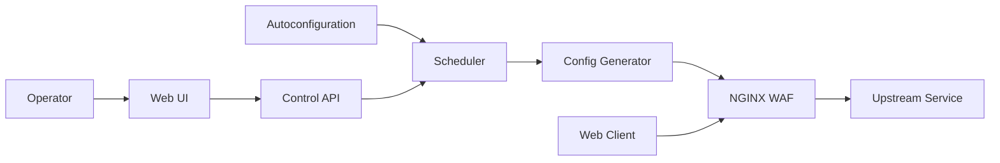

# bunkerity/bunkerweb

> NGINX-based web application firewall (WAF), deployed as a reverse proxy in front of your services.

## The problem
Hardening a reverse proxy (TLS, headers, ModSecurity, anti-bots, limits) requires a lot of manual configuration and expertise.

## What it actually does
Preconfigured NGINX with ModSecurity + OWASP CRS, automatic Let's Encrypt, banning on HTTP codes, anti-bot challenges, blacklists.
Configuration through variables (`USE_ANTIBOT`, `AUTO_LETS_ENCRYPT`…), multisite, custom NGINX conf.
A scheduler stores state in a database (SQLite/MariaDB/MySQL/PostgreSQL) and generates the config; web UI, CLI, API.
Autoconf for Docker, Swarm, Kubernetes (Ingress); plugins (ClamAV, Coraza, VirusTotal, webhooks).

## How it is wired


## Trying it
No installation command in the README: it points to the Linux/Docker/Kubernetes sections of the docs. Example config:
```bash
SERVER_NAME=www.example.com
AUTO_LETS_ENCRYPT=yes
USE_ANTIBOT=captcha
```

## Cost and gotchas
Open source AGPLv3; paid PRO version and Cloud SaaS offering. WAF false positives to be tuned (security tuning).

## What it is not
Not a "set and forget" solution: the defaults give a minimum, tuning is recommended. Some features (couronne) are reserved for PRO.

## Alternatives
- Coraza (plugin): WAF engine alternative to ModSecurity within BunkerWeb itself.

## For you
To ignore for your profile: a web infra/security tool, useful only if you expose a model API yourself without an ops team.
