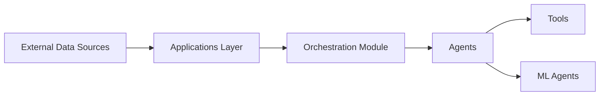

# business-science/ai-data-science-team

> Library of specialized agents for data science workflows, with a Streamlit pipeline app.

## The problem
Repetitive data science tasks (loading, cleaning, visualization, modeling) take time.

## What it actually does
Python agents to load, clean, transform, visualize, do EDA and feature engineering, query a SQL database, and model with H2O and MLflow. Multi-agents and a supervisor agent combine them. The AI Pipeline Studio app keeps a reproducible lineage with a visual editor, tables, charts and scripts. Works with OpenAI or Ollama.

## How it is wired


## Trying it
```bash
pip install -e .
streamlit run apps/ai-pipeline-studio-app/app.py
```

## Cost and gotchas
OpenAI key or a local Ollama server. Python 3.10+. LLM-generated code is executed: review it.

## What it is not
Beta status: "Breaking changes may occur until 0.1.0". The last push dates from January 2026. The README also promotes a paid workshop.

## Alternatives
The README names no alternative.

## For you
Worth watching: a good testing ground for a data scientist, but beta and a single author; do not put it at the heart of a pipeline.
