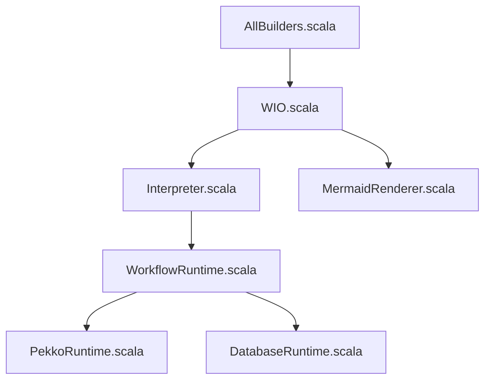

# business4s/workflows4s

> Scala library for long-running, stateful workflows, inspired by Temporal, BPMN and event sourcing.

## The problem
Long-running stateful processes need an execution engine, often an opaque one.

## What it actually does
Based on the code, a workflow is described with the `WIO` type via builders, then an interpreter runs it in a runtime of your choice (Pekko, database with Doobie, in-memory with cats-effect). A web API and an interface expose the instances, and `MermaidRenderer` draws the diagrams. The README is very short.

## How it is wired
Diagram based on the code diagram.



## Trying it
```bash
# Aucune commande documentée dans le README : voir le site du projet
```

## Cost and gotchas
Free. Scala and the JVM are required (not in the prerequisites list). The README points to the website and Discord for everything else.

## What it is not
Not a hosted service like Temporal: a library embedded in a Scala application.

## Alternatives
- Temporal: cited as the execution model the project draws inspiration from.

## For you
Keep an eye on it: interesting durable-workflow concept, but in Scala, so useful only if you are on that stack.
