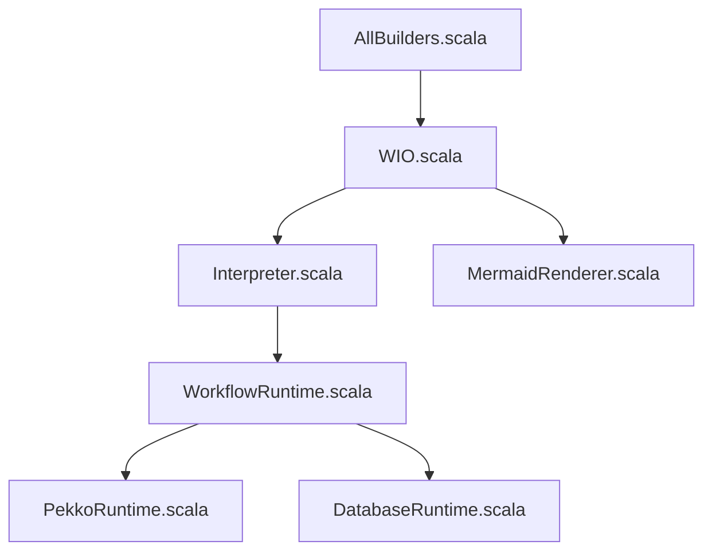

# business4s/workflows4s

> Bibliothèque Scala de workflows longs et à état, inspirée de Temporal, BPMN et l'event sourcing.

## Le problème
Les processus longs avec état demandent un moteur d'exécution, souvent opaque.

## Ce que ça fait vraiment
D'après le code, un workflow se décrit avec le type `WIO` via des builders, puis un interpréteur l'exécute dans un runtime au choix (Pekko, base de données avec Doobie, mémoire avec cats-effect). Une API web et une interface exposent les instances, et `MermaidRenderer` dessine les diagrammes. Le README est très court.

## Comment c'est branché
Schéma d'après le diagramme du code.



## Essayer
```bash
# Aucune commande documentée dans le README : voir le site du projet
```

## Coût et pièges
Gratuit. Scala et JVM nécessaires (hors liste des prérequis). Le README renvoie au site et à Discord pour tout le reste.

## Ce que ce n'est pas
Pas un service hébergé comme Temporal : une bibliothèque embarquée dans une application Scala.

## Alternatives
- Temporal : cité comme modèle d'exécution dont le projet s'inspire.

## Pour toi
Surveiller : concept intéressant de workflows durables, mais en Scala, donc utile seulement si tu es sur cette stack.

