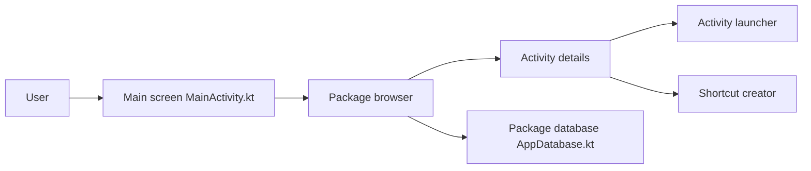

# butzist/ActivityLauncher

> Android application that launches hidden activities and creates shortcuts for installed apps.

## The problem
Some Android activities have no launcher icon and remain inaccessible to the user.

## What it actually does
The README is minimal (under 800 characters). The architecture described from the code shows a walk through installed packages and their activities, the detail of an activity, its launch, and the creation or sharing of shortcuts. Favorites, recents, settings and launch plugins (for example Shizuku) complete the whole.

## How it is wired

## Trying it
No documented command.

## Cost and gotchas
Nothing stated about cost or prerequisites. Translations go through pull requests.

## What it is not
Not an automation or testing tool: the README says nothing about the target audience beyond launching and shortcuts.

## Alternatives
The README names no alternative.

## For you
Ignore: an Android utility unrelated to data or AI, and the README is too thin to judge further.
