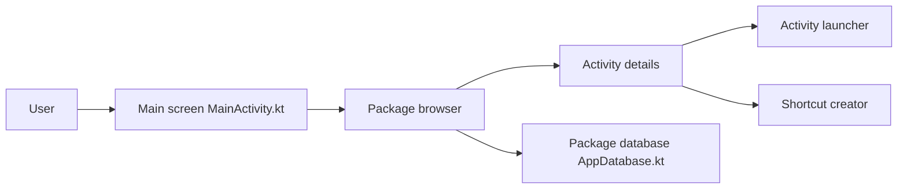

# butzist/ActivityLauncher

> Application Android qui lance des activités cachées et crée des raccourcis pour les applis installées.

## Le problème
Certaines activités Android n'ont pas d'icône de lancement et restent inaccessibles à l'utilisateur.

## Ce que ça fait vraiment
Le README est minimal (moins de 800 caractères). L'architecture décrite d'après le code montre un parcours des paquets installés et de leurs activités, le détail d'une activité, son lancement et la création ou le partage de raccourcis. Favoris, récents, paramètres et plugins de lancement (par exemple Shizuku) complètent l'ensemble.

## Comment c'est branché

## Essayer
Aucune commande documentée.

## Coût et pièges
Rien d'indiqué sur le coût ni les prérequis. Les traductions passent par des pull requests.

## Ce que ce n'est pas
Pas un outil d'automatisation ni de test : le README ne dit rien du public visé au-delà du lancement et des raccourcis.

## Alternatives
Le README ne nomme pas d'alternative.

## Pour toi
Ignorer : utilitaire Android sans lien avec la data ou l'IA, et le README trop mince pour juger plus loin.

