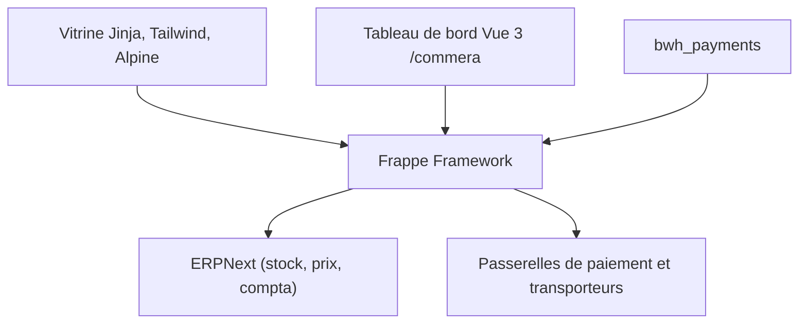

# bwhtech/commera

> Open source online store and merchant dashboard, built on ERPNext.

## The problem
ERPNext stores force a choice between a fast but painful-to-administer portal and a separate platform that has to be reconciled.

## What it actually does
The storefront is server-side rendered (Jinja, Tailwind, Alpine), bilingual and right-to-left compatible. The merchant dashboard in Vue 3 and Frappe UI handles orders, products, customers and analytics. Payments (Razorpay, Stripe, Telr, Tabby, cash on delivery) and shipping (Shiprocket, AfterShip) are configured from this dashboard. ERPNext remains the source of truth.

## How it is wired

## Trying it
No command documented in the provided README.

## Cost and gotchas
You need an ERPNext site and the companion app bwh_payments. Each payment gateway or carrier requires its own account and credentials. The licence is not identified by GitHub.

## What it is not
It is not a standalone platform: without ERPNext, nothing works. The gateways mainly target India and the Middle East.

## Alternatives
- No alternative named in the README.

## For you
Ignore: an e-commerce tool on ERPNext, unrelated to a data / AI / MLOps profile.
