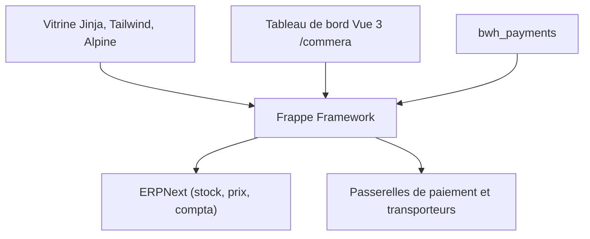

# bwhtech/commera

> Boutique en ligne et tableau de bord marchand open source, construits sur ERPNext.

## Le problème
Les boutiques ERPNext obligent à choisir entre un portail rapide mais pénible à administrer et une plateforme séparée à réconcilier.

## Ce que ça fait vraiment
La vitrine est rendue côté serveur (Jinja, Tailwind, Alpine), bilingue et compatible droite-gauche. Le tableau de bord marchand en Vue 3 et Frappe UI gère commandes, produits, clients et analytics. Paiements (Razorpay, Stripe, Telr, Tabby, paiement à la livraison) et livraison (Shiprocket, AfterShip) se configurent depuis ce tableau. ERPNext reste la source de vérité.

## Comment c'est branché

## Essayer
Aucune commande documentée dans le README fourni.

## Coût et pièges
Il faut un site ERPNext et l'application compagnon bwh_payments. Chaque passerelle de paiement ou transporteur demande son propre compte et ses identifiants. La licence n'est pas identifiée par GitHub.

## Ce que ce n'est pas
Ce n'est pas une plateforme autonome : sans ERPNext, rien ne fonctionne. Les passerelles visent surtout l'Inde et le Moyen-Orient.

## Alternatives
- Aucune alternative nommée dans le README.

## Pour toi
À ignorer : outil de e-commerce sur ERPNext, sans rapport avec un profil data / IA / MLOps.

