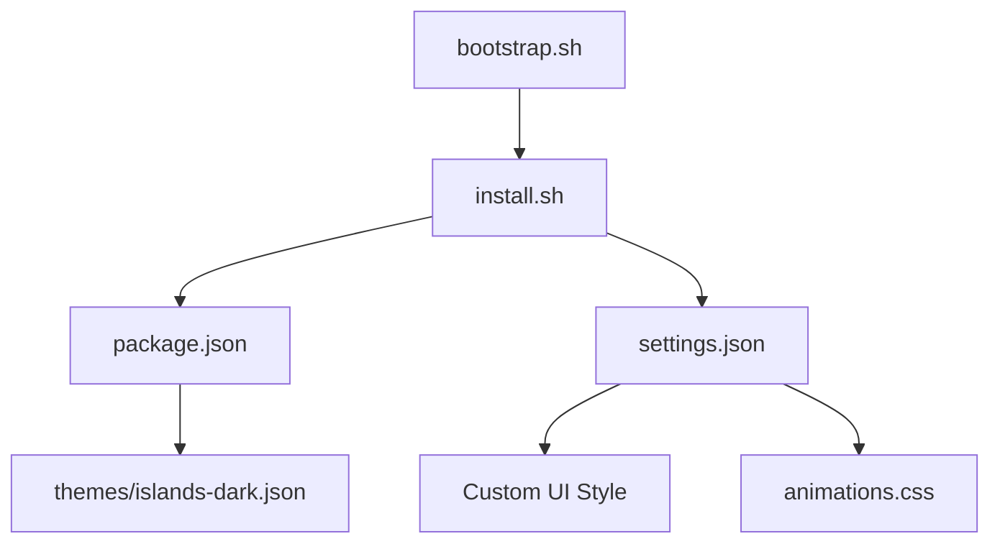

# bwya77/vscode-dark-islands

> Dark theme for VS Code and its derivatives, with floating glass panels and rounded corners.

## The problem
Classic themes only change colors. This one also wants an interface with floating panels, inspired by the easemate editor.

## What it actually does
Two parts: a color theme (extension) and CSS rules injected by the third-party Custom UI Style extension, which modifies the editor's files. Scripts also install fonts, back up settings and support VS Code, VSCodium, Cursor and Antigravity, with a Nix variant.

## How it is wired


## Trying it
```bash
curl -fsSL https://raw.githubusercontent.com/bwya77/vscode-dark-islands/main/bootstrap.sh | bash
git clone https://github.com/bwya77/vscode-dark-islands.git islands-dark
cd islands-dark
./install.sh
```

## Cost and gotchas
Free. The styling relies on CSS injection: a "corrupt installation" warning, to be redone after each editor update. The IBM Plex Mono and FiraCode Nerd Font fonts must be installed separately. No license declared.

## What it is not
It is not an official editor theme: it modifies the interface through an unsupported workaround, as the README itself admits for Cursor. The `curl | bash` commands run a remote script.

## Alternatives
No alternative named in the README.

## For you
Ignore: a matter of taste, and the CSS injection plus an unlicensed remote script weigh against using it on a workstation.
