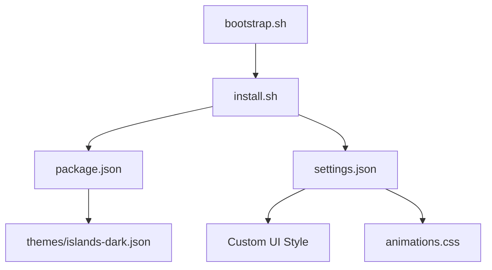

# bwya77/vscode-dark-islands

> Thème sombre pour VS Code et ses dérivés, avec panneaux flottants en verre et coins arrondis.

## Le problème
Les thèmes classiques ne changent que les couleurs. Celui-ci veut aussi une interface à panneaux flottants, inspirée de l'éditeur easemate.

## Ce que ça fait vraiment
Deux parties : un thème de couleurs (extension) et des règles CSS injectées par l'extension tierce Custom UI Style, qui modifie les fichiers de l'éditeur. Des scripts installent aussi des polices, sauvegardent les réglages et prennent en charge VS Code, VSCodium, Cursor et Antigravity, avec une variante Nix.

## Comment c'est branché


## Essayer
```bash
curl -fsSL https://raw.githubusercontent.com/bwya77/vscode-dark-islands/main/bootstrap.sh | bash
git clone https://github.com/bwya77/vscode-dark-islands.git islands-dark
cd islands-dark
./install.sh
```

## Coût et pièges
Gratuit. Le style repose sur une injection CSS : avertissement « installation corrompue », à refaire après chaque mise à jour de l'éditeur. Les polices IBM Plex Mono et FiraCode Nerd Font sont à installer à part. Aucune licence déclarée.

## Ce que ce n'est pas
Ce n'est pas un thème officiel de l'éditeur : il modifie l'interface par un contournement non pris en charge, de l'aveu du README pour Cursor. Les commandes `curl | bash` exécutent un script distant.

## Alternatives
Aucune alternative nommée dans le README.

## Pour toi
À ignorer : une question de goût, et l'injection CSS plus un script distant sans licence pèsent contre l'usage sur un poste de travail.

