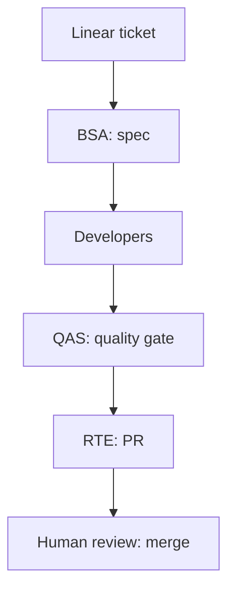

# bybren-llc/safe-agentic-workflow

> A repository template that frames teams of AI agents with hooks, commands, and skills, following the SAFe method.

## The problem
AI agents without roles or guardrails produce unverified work that's hard to review and coordinate.

## What it actually does
Provides a harness to copy into your project: 20 skills, 24 slash commands, 11 agent profiles (BSA, QAS, RTE…) and three layers (hooks, commands, skills). It targets Claude Code, Gemini CLI, Codex CLI, and Cursor. A sync script updates the harness, and a "Knowledge Vault" checks the freshness of knowledge per commit.

## How it is wired
Simplified diagram based on the fiche, no diagram provided.



## Trying it
```bash
cp -r .claude/ /your-project/.claude/
bash scripts/setup-template.sh
/start-work TICKET-123
```

## Cost and gotchas
Agents consume your key or subscription (Anthropic, Google, OpenAI). Placeholders (`{{TICKET_PREFIX}}`…) must be replaced and it assumes a Linear ticket tracker. Truncated README: the rest was not read.

## What it is not
Not an installable library: it's a template to copy. Uses outside software engineering (marketing, research) are documented but not validated in production.

## Alternatives
No alternative named in the README.

## For you
To watch: useful as a source of ideas for roles and quality gates for agents, too SAFe- and Linear-oriented to adopt as-is.
