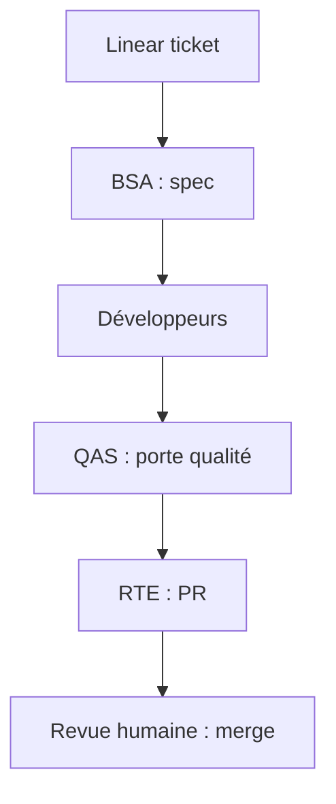

# bybren-llc/safe-agentic-workflow

> Modèle de dépôt qui encadre des équipes d'agents IA par hooks, commandes et skills, selon la méthode SAFe.

## Le problème
Des agents IA sans rôles ni garde-fous produisent un travail non vérifié, difficile à relire et à coordonner.

## Ce que ça fait vraiment
Fournit un harnais à copier dans son projet : 20 skills, 24 commandes slash, 11 profils d'agents (BSA, QAS, RTE…) et trois couches (hooks, commandes, skills). Il vise Claude Code, Gemini CLI, Codex CLI et Cursor. Un script de synchronisation met à jour le harnais, et un « Knowledge Vault » vérifie la fraîcheur des connaissances par commit.

## Comment c'est branché
Schéma simplifié d'après la fiche, sans diagramme fourni.



## Essayer
```bash
cp -r .claude/ /your-project/.claude/
bash scripts/setup-template.sh
/start-work TICKET-123
```

## Coût et pièges
Les agents consomment ta clé ou ton abonnement (Anthropic, Google, OpenAI). Il faut remplacer les placeholders (`{{TICKET_PREFIX}}`…) et suppose un suivi de tickets Linear. README tronqué : la suite n'a pas été lue.

## Ce que ce n'est pas
Pas une bibliothèque installable : c'est un modèle à copier. Les usages hors génie logiciel (marketing, recherche) sont documentés mais non validés en production.

## Alternatives
Aucune alternative nommée dans le README.

## Pour toi
Surveiller : utile comme source d'idées de rôles et de portes qualité pour agents, trop orienté SAFe et Linear pour une adoption telle quelle.

