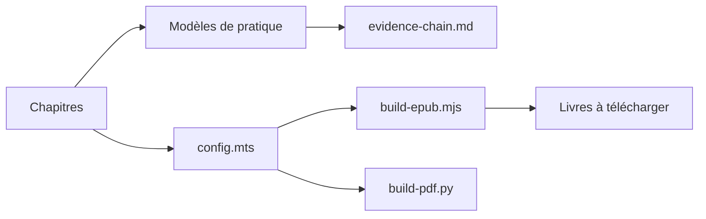

# byoungd/up

> Open-access Chinese book on lifelong learning in the age of AI.

## The problem
The text is aimed at people who want to keep learning despite rapid change, using AI without delegating their judgment to it.

## What it actually does
Updated manuscript, in Chinese with an English version, published as a site (VitePress) and as EPUB/PDF. Five parts: reading, repositioning yourself in life, tools including AI, practice and recovery, a 90-day action plan. It offers tracking templates and a "problem, learning, AI, real task, proof, review" cycle. The author discloses a commercial link with his company.

## How it is wired

## Trying it
No command documented: read the GitHub Pages site or download the books.

## Cost and gotchas
Free. Licenses declared in the README: content CC BY-NC 4.0, code and configuration MIT; GitHub does not identify them. The text is in Chinese.

## What it is not
It is not software or a technical AI course, and the README states that it is not medical, legal or investment advice.

## Alternatives
No alternative named in the README.

## For you
Ignore: personal reading with no tooling for your work, and a non-commercial license on the text.
