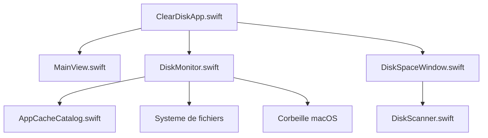

# bysiber/cleardisk

> macOS menu bar app that finds and cleans development caches, for Mac developers.

## The problem
Xcode, npm, Docker, pip or Cargo fill the disk with forgotten caches, and general-purpose cleaners don't know what is safe to delete.

## What it actually does
Scans known cache paths (79 advertised) and project artifacts (`node_modules`, `.venv`, `build`...). Shows the recoverable size with a risk level (safe, caution, risky). Moves the selected items to the Trash rather than deleting them. Warns when the disk is filling up and predicts the date of saturation.

## How it is wired


## Trying it
```bash
brew tap bysiber/cleardisk
brew trust bysiber/cleardisk
brew install --cask cleardisk
```

## Cost and gotchas
Free, macOS 14 minimum. Building from source requires the Xcode Command Line Tools. The Docker folder is rated "risky": read before clicking.

## What it is not
Not a Linux or Windows tool. Not a personal data cleaner: it only targets development caches. Space is only actually freed once the Trash is emptied.

## Alternatives
- DevCleaner for Xcode: handles only Xcode, but older and well known.
- npkill: command-line, focused on `node_modules`.
- DaisyDisk: paid visualization, with no notion of deletion safety.

## For you
Worth watching: useful if you code on a Mac with Hugging Face, conda or Docker caches that keep growing, but it is a one-person project, and young (created in 2026).
