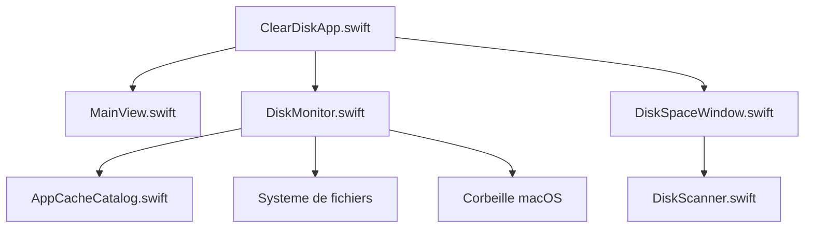

# bysiber/cleardisk

> Application macOS dans la barre de menus qui repère et nettoie les caches de développement, pour développeurs Mac.

## Le problème
Xcode, npm, Docker, pip ou Cargo remplissent le disque de caches oubliés, et les nettoyeurs généralistes ne savent pas ce qui est sans risque à supprimer.

## Ce que ça fait vraiment
Scanne des chemins de caches connus (79 annoncés) et des artefacts de projets (`node_modules`, `.venv`, `build`…). Affiche la taille récupérable avec un niveau de risque (sûr, prudence, risqué). Déplace les éléments choisis vers la Corbeille plutôt que de les supprimer. Prévient quand le disque se remplit et prévoit la date de saturation.

## Comment c'est branché


## Essayer
```bash
brew tap bysiber/cleardisk
brew trust bysiber/cleardisk
brew install --cask cleardisk
```

## Coût et pièges
Gratuit, macOS 14 minimum. Compiler depuis les sources demande les Xcode Command Line Tools. Le dossier Docker est classé « risqué » : à lire avant de cliquer.

## Ce que ce n'est pas
Pas un outil Linux ni Windows. Pas un nettoyeur de données personnelles : il ne vise que les caches de développement. L'espace n'est réellement libéré qu'une fois la Corbeille vidée.

## Alternatives
- DevCleaner for Xcode : ne traite que Xcode, mais plus ancien et connu.
- npkill : en ligne de commande, centré sur `node_modules`.
- DaisyDisk : visualisation payante, sans notion de sécurité de suppression.

## Pour toi
À surveiller : utile si tu codes sur Mac avec des caches Hugging Face, conda ou Docker qui gonflent, mais c'est un projet d'une seule personne, jeune (créé en 2026).

