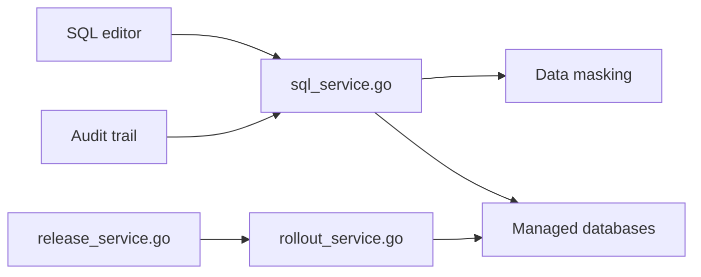

# bytebase/bytebase

> Database governance platform: changes, access and compliance for teams and AI agents.

## The problem
Migration scripts, SQL clients and tickets are scattered: who changed or read what stays unclear.

## What it actually does
Web console to request, review, deploy and roll back schema changes; SQL review (200+ lint rules); GitHub/GitLab GitOps; RBAC, time-limited access, dynamic column masking; audit log. On the AI side: MCP server, text-to-SQL, built-in agent.

## How it is wired


## Trying it
```bash
docker run --init \
  --name bytebase \
  --publish 8080:8080 \
  --volume ~/.bytebase/data:/var/opt/bytebase \
  bytebase/bytebase:latest
```

## Cost and gotchas
Free version, with paid plans not detailed in the README. License present but not identified by GitHub.

## What it is not
Not a migration-only tool: it is a full control plane, hence heavy for a small project.

## Alternatives
Comparisons listed in the README: Liquibase, Flyway, DBeaver, DataGrip, Navicat, CloudBeaver, Jira.

## For you
Worth watching: useful if several people or agents touch production databases; license to verify.
