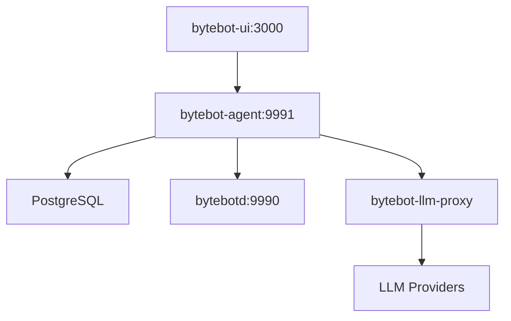

# bytebot-ai/bytebot

> AI agent with its own virtual Ubuntu desktop, to carry out tasks described in natural language.

## The problem
Agents limited to the browser or to APIs cannot use desktop software or handle local files.

## What it actually does
Provides a containerized Ubuntu/XFCE desktop that the agent drives (mouse, keyboard, screenshots). A web interface lets you create tasks, watch the desktop live and take back control. REST APIs let you create tasks and drive the desktop. Models go through a LiteLLM proxy.

## How it is wired


## Trying it
```bash
git clone https://github.com/bytebot-ai/bytebot.git
cd bytebot
echo "ANTHROPIC_API_KEY=sk-ant-..." > docker/.env
docker-compose -f docker/docker-compose.yml up -d
# ouvrir http://localhost:9992
```

## Cost and gotchas
Model calls are billed to you. Docker required. The repository is archived and its last push dates from September 2025.

## What it is not
Not a maintained product: no more fixes expected. Credentials typed into the desktop (password managers) remain your responsibility.

## Alternatives
No alternative named in the README.

## For you
Ignore for production since it is archived; read only as an example of an agent plus virtual desktop architecture.
