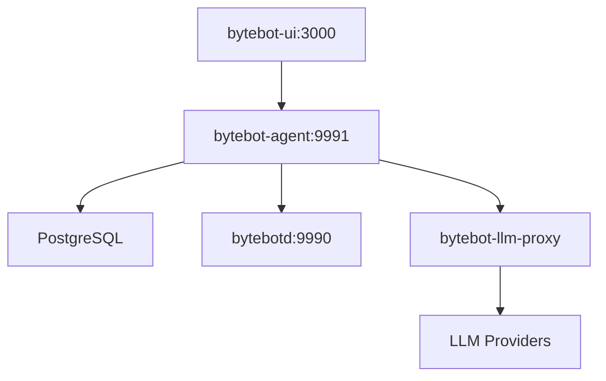

# bytebot-ai/bytebot

> Agent IA doté de son propre bureau Ubuntu virtuel, pour exécuter des tâches décrites en langage naturel.

## Le problème
Les agents limités au navigateur ou aux API ne savent pas utiliser un logiciel de bureau ni manipuler des fichiers locaux.

## Ce que ça fait vraiment
Fournit un bureau Ubuntu/XFCE conteneurisé que l'agent pilote (souris, clavier, captures). Une interface web permet de créer des tâches, de regarder le bureau en direct et de reprendre la main. Des API REST permettent de créer des tâches et de piloter le bureau. Les modèles passent par un proxy LiteLLM.

## Comment c'est branché


## Essayer
```bash
git clone https://github.com/bytebot-ai/bytebot.git
cd bytebot
echo "ANTHROPIC_API_KEY=sk-ant-..." > docker/.env
docker-compose -f docker/docker-compose.yml up -d
# ouvrir http://localhost:9992
```

## Coût et pièges
Les appels au modèle sont facturés à ta charge. Docker obligatoire. Le dépôt est archivé et son dernier push date de septembre 2025.

## Ce que ce n'est pas
Pas un produit maintenu : plus de correctifs attendus. Les identifiants saisis dans le bureau (gestionnaires de mots de passe) restent sous ta responsabilité.

## Alternatives
Aucune alternative nommée dans le README.

## Pour toi
À ignorer en production car archivé ; à lire seulement comme exemple d'architecture agent plus bureau virtuel.

