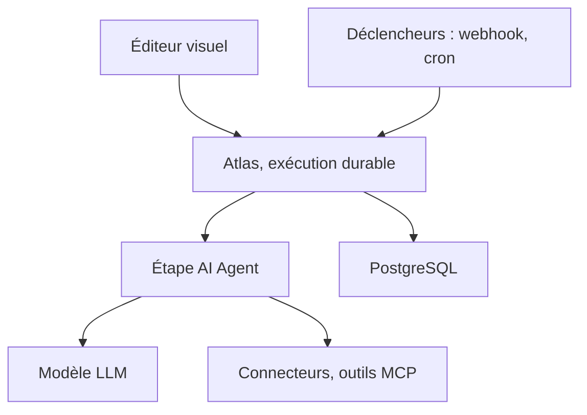

# bytechefhq/bytechef

> Open source AI agent and workflow automation platform, to self-host or embed.

## The problem
AI agents and deterministic workflows live in separate tools, with no shared crash recovery or audit trail.

## What it actually does
A visual editor where the AI agent is a step in a durable workflow: each execution is recorded in Postgres and resumes where it stopped. More than 250 connectors also serve as agent tools and MCP tools. It offers knowledge bases, guardrails, JS, Python or Ruby code, human approvals and a copilot (EE edition).

## How it is wired
Simplified diagram based on the sheet, no diagram provided.



## Trying it
```bash
docker run --name bytechef -it -p 8080:8080 \
    --env BYTECHEF_DATABASE=h2 \
    --env BYTECHEF_AI_MEMORY_PROVIDER=in_memory \
    -v ~/.bytechef:/root/.bytechef \
    docker.bytechef.io/bytechef/bytechef:latest
curl -O https://raw.githubusercontent.com/bytechefhq/bytechef/master/docker-compose.yml
docker compose -f docker-compose.yml up
```

## Cost and gotchas
H2 is for evaluation only, with no migration to PostgreSQL. Agents need a model API key (or Ollama locally). EE features are under an enterprise license.

## What it is not
Not a library like LangChain: it is a complete system to run. Agent skills and evaluations are still in development.

## Alternatives
n8n, Zapier and Make are cited by the README as competitors: n8n under a restricted-use license, the other two as closed SaaS.

## For you
Worth watching: useful for orchestrating agents with error recovery, but the boundary between the Apache core and the EE edition needs checking.
