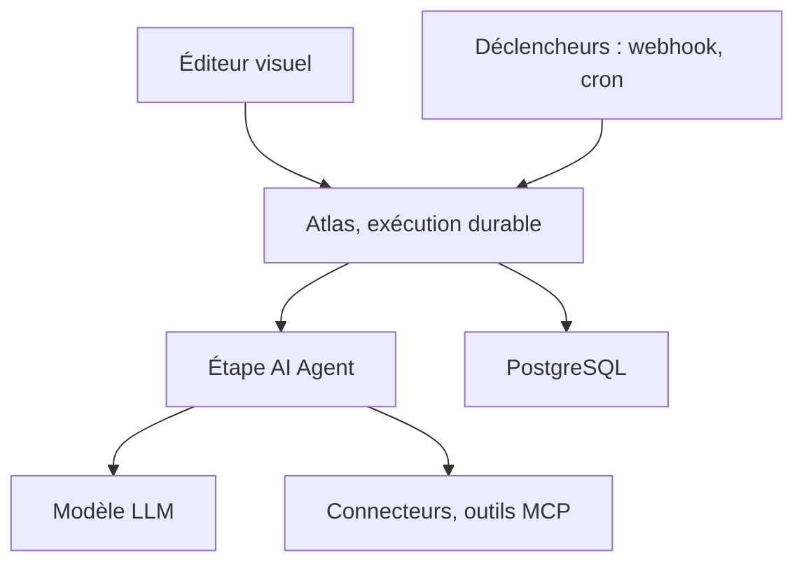

# bytechefhq/bytechef

> Plateforme open source d'agents IA et d'automatisation de workflows, à héberger soi-même ou à embarquer.

## Le problème
Les agents IA et les workflows déterministes vivent dans des outils séparés, sans reprise après panne ni piste d'audit commune.

## Ce que ça fait vraiment
Un éditeur visuel où l'agent IA est une étape d'un workflow durable : chaque exécution est enregistrée dans Postgres et reprend là où elle s'est arrêtée. Plus de 250 connecteurs servent aussi d'outils d'agent et d'outils MCP. Il propose bases de connaissances, garde-fous, code JS, Python ou Ruby, approbations humaines et copilote (édition EE).

## Comment c'est branché
Schéma simplifié d'après la fiche, sans diagramme fourni.



## Essayer
```bash
docker run --name bytechef -it -p 8080:8080 \
    --env BYTECHEF_DATABASE=h2 \
    --env BYTECHEF_AI_MEMORY_PROVIDER=in_memory \
    -v ~/.bytechef:/root/.bytechef \
    docker.bytechef.io/bytechef/bytechef:latest
curl -O https://raw.githubusercontent.com/bytechefhq/bytechef/master/docker-compose.yml
docker compose -f docker-compose.yml up
```

## Coût et pièges
H2 sert à l'évaluation seulement, sans migration vers PostgreSQL. Les agents demandent une clé d'API de modèle (ou Ollama en local). Les fonctions EE sont sous licence entreprise.

## Ce que ce n'est pas
Pas une bibliothèque comme LangChain : c'est un système complet à faire tourner. Agent skills et évaluations sont encore en développement.

## Alternatives
n8n, Zapier et Make sont cités par le README comme concurrents : n8n sous une licence à usage restreint, les deux autres en SaaS fermé.

## Pour toi
À surveiller : utile pour orchestrer des agents avec reprise sur erreur, mais la frontière entre cœur Apache et édition EE est à vérifier.

