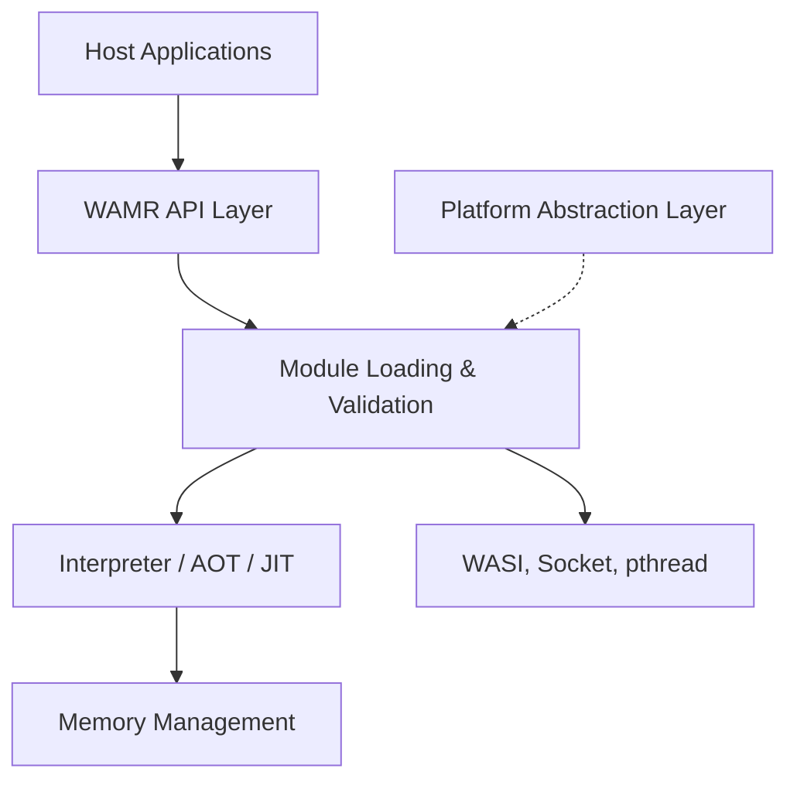

# bytecodealliance/wasm-micro-runtime

> A lightweight, embeddable WebAssembly runtime for embedded systems, edge and trusted environments.

## The problem
Running WebAssembly on a microcontroller or at the edge requires a very small runtime, which browser engines do not offer.

## What it actually does
`VMcore` loads and runs Wasm modules with an interpreter, AOT or JIT (Fast JIT, LLVM JIT). `iwasm` is the executable with WASI, `wamrc` compiles to AOT. C APIs let you embed it, with Go, Python and Rust bindings.

## How it is wired


## Trying it
```bash
# Le README renvoie à des guides de compilation (VM core, iwasm, wamrc) ;
# aucune commande n'y figure.
```

## Cost and gotchas
Free. Building depends on the target platform, with one build per target. The repository announces a move to the `wasm-micro-runtime` organization, and the wamr.dev domain has not yet been transferred. 656 open issues.

## What it is not
It is not a browser Wasm engine nor a cloud orchestrator: it is a building block to embed in a host application.

## Alternatives
The README names none.

## For you
Worth watching: interesting for edge inference or isolated plugins, but the need remains niche for a data / AI / MLOps profile.
