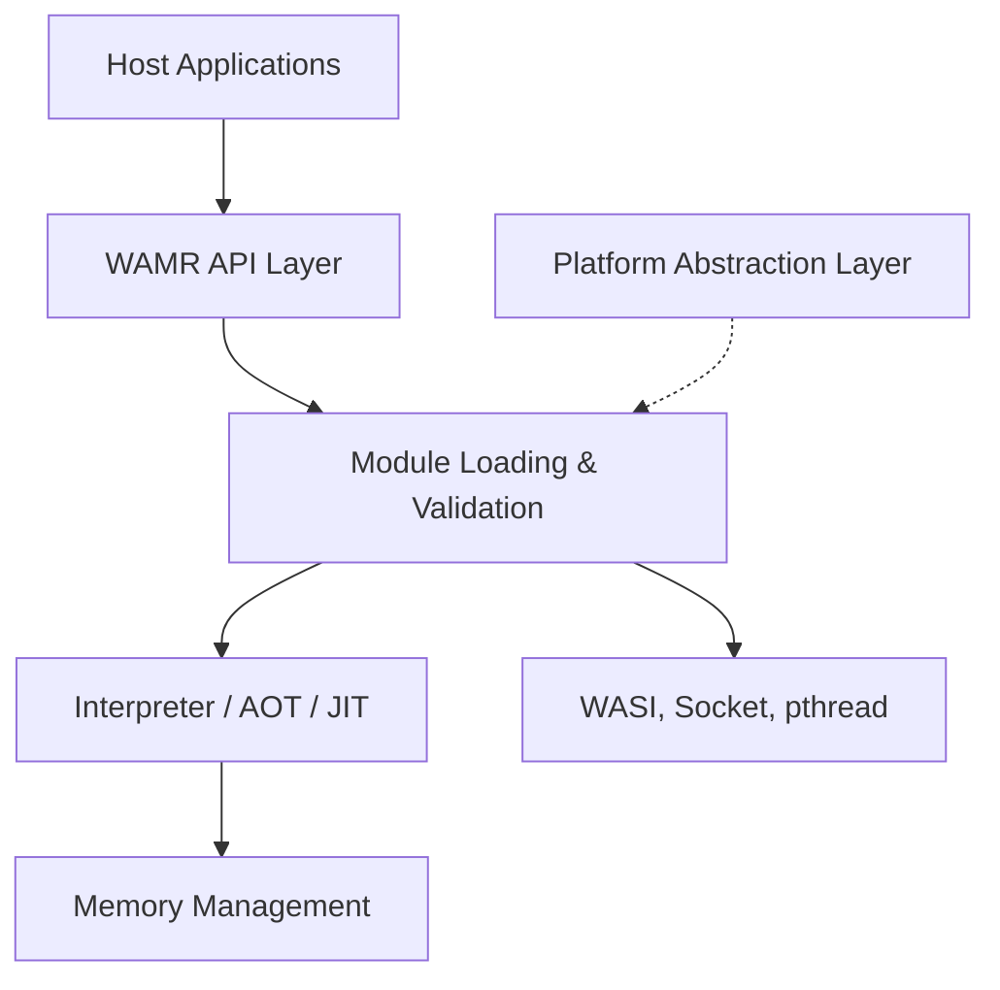

# bytecodealliance/wasm-micro-runtime

> Runtime WebAssembly léger, embarquable, pour l'embarqué, l'edge et les environnements de confiance.

## Le problème
Exécuter du WebAssembly sur un microcontrôleur ou en périphérie demande un runtime très petit, que les moteurs de navigateur n'offrent pas.

## Ce que ça fait vraiment
`VMcore` charge et exécute des modules Wasm en interpréteur, AOT ou JIT (Fast JIT, LLVM JIT). `iwasm` est l'exécutable avec WASI, `wamrc` compile en AOT. Des API C permettent de l'embarquer, avec liaisons Go, Python et Rust.

## Comment c'est branché


## Essayer
```bash
# Le README renvoie à des guides de compilation (VM core, iwasm, wamrc) ;
# aucune commande n'y figure.
```

## Coût et pièges
Gratuit. La compilation dépend de la plateforme cible, avec un build par cible. Le dépôt annonce un déménagement vers l'organisation `wasm-micro-runtime`, et le domaine wamr.dev n'est pas encore transféré. 656 issues ouvertes.

## Ce que ce n'est pas
Ce n'est pas un moteur Wasm de navigateur ni un orchestrateur cloud : c'est une brique à embarquer dans une application hôte.

## Alternatives
Le README n'en nomme aucune.

## Pour toi
À surveiller : intéressant pour de l'inférence en périphérie ou des plugins isolés, mais le besoin reste de niche pour un profil data / IA / MLOps.

