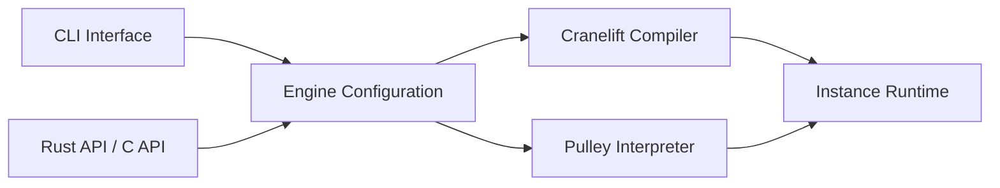

# bytecodealliance/wasmtime

> Standalone, fast and secure WebAssembly runtime, with the Cranelift compiler, a CLI and an embedding API.

## The problem
Running WebAssembly code outside the browser, in an isolated and standard way, from an application or the command line.

## What it actually does
A configurable `Engine` compiles (Cranelift, JIT or ahead-of-time) or interprets (Pulley), instantiates modules, calls exports and returns values or traps. WASI and component support, Rust and C APIs. Continuous fuzzing by OSS-Fuzz, RFC process, security policy.

## How it is wired


## Trying it
```console
curl https://wasmtime.dev/install.sh -sSf | bash
rustup target add wasm32-wasip2
rustc hello.rs --target wasm32-wasip2
wasmtime hello.wasm
```

## Cost and gotchas
Free. Installation through `curl | bash` and a Rust installed via `rustup` for the example. 885 open issues.

## What it is not
Not a language nor an orchestrator: a runtime to embed. Not an AI tool.

## Alternatives
No alternative named in the README.

## For you
Useful if you isolate untrusted code (plugins, agents) in a WASM sandbox; worth watching.
