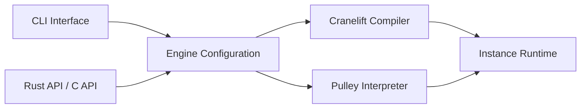

# bytecodealliance/wasmtime

> Runtime WebAssembly autonome, rapide et sécurisé, avec compilateur Cranelift, CLI et API d'intégration.

## Le problème
Exécuter du code WebAssembly hors navigateur, de façon isolée et standard, depuis une application ou en ligne de commande.

## Ce que ça fait vraiment
Un `Engine` configurable compile (Cranelift, JIT ou ahead-of-time) ou interprète (Pulley), instancie les modules, appelle les exports et renvoie valeurs ou traps. Support WASI et composants, API Rust et C. Fuzzing continu par OSS-Fuzz, processus RFC, politique de sécurité.

## Comment c'est branché


## Essayer
```console
curl https://wasmtime.dev/install.sh -sSf | bash
rustup target add wasm32-wasip2
rustc hello.rs --target wasm32-wasip2
wasmtime hello.wasm
```

## Coût et pièges
Gratuit. L'installation par `curl | bash` et un Rust installé via `rustup` pour l'exemple. 885 issues ouvertes.

## Ce que ce n'est pas
Pas un langage ni un orchestrateur : un runtime à embarquer. Pas un outil d'IA.

## Alternatives
Aucune alternative nommée dans le README.

## Pour toi
Utile si tu isoles du code non fiable (plugins, agents) dans un sandbox WASM ; à surveiller.

