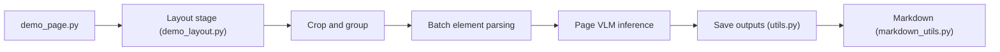

# bytedance/Dolphin

> Two-step document image analysis model: layout first, then element parsing.

## The problem
Pages mix text, tables, formulas and code, photographed or native; extracting them cleanly with reading order is hard.

## What it actually does
Step 1: classification of the document type (native or photographed) and layout analysis with reading order. Step 2: global parsing for photos, parallel element-by-element parsing for digital documents. JSON and Markdown outputs. Three scripts: page, layout, element. Dolphin-v2 (3B) reports 89.78 on OmniDocBench v1.5 according to the README.

## How it is wired


## Trying it
```bash
git clone https://github.com/ByteDance/Dolphin.git
cd Dolphin
pip install -r requirements.txt
git clone https://huggingface.co/ByteDance/Dolphin-v2 ./hf_model
python demo_page.py --model_path ./hf_model --save_dir ./results --input_path ./demo/page_imgs/page_1.png
```

## Cost and gotchas
Free, but the model weights must be downloaded and a GPU is likely needed (not specified). A license is present but not identified: read it before any commercial use.

## What it is not
Not a ready-to-use service; demo scripts. Last push in March 2026.

## Alternatives
None named in the README (benchmark on OmniDocBench).

## For you
Worth watching: useful for RAG pipelines over PDFs/scans, but check the license and measure on your own documents.
