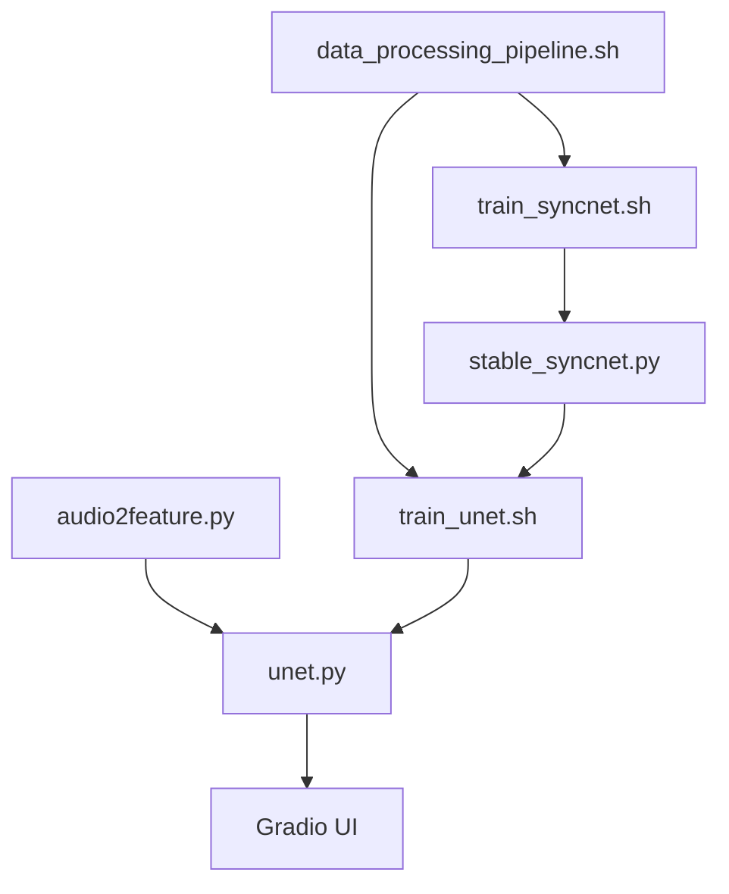

# bytedance/LatentSync

> Lip-sync model based on audio-conditioned latent diffusion, with training code.

## The problem
Lip-sync methods based on pixel-space or two-stage diffusion are heavy and produce temporal artifacts.

## What it actually does
Whisper encodes the audio, injected by cross-attention into a Stable Diffusion-style U-Net with reference and masked images.
TREPA, LPIPS and SyncNet losses in pixel space during training.
Inference through a Gradio app or script; complete data preparation pipeline (scenes, InsightFace faces, sync and quality filtering).
U-Net and SyncNet training scripts, and evaluation scripts.

## How it is wired


## Trying it
```bash
source setup_env.sh
python gradio_app.py
./inference.sh
./data_processing_pipeline.sh
./train_unet.sh
```

## Cost and gotchas
Inference: 8 GB of VRAM (v1.5) to 18 GB (v1.6); training 20 to 55 GB depending on the config.

## What it is not
Not a ready-to-use service nor a real-time solution. Use on real faces raises consent questions (deepfake).

## Alternatives
No alternative named in the README.

## For you
Watch: a solid open source reference for generative video, but with no commit for over a year and outside the data/MLOps core.
