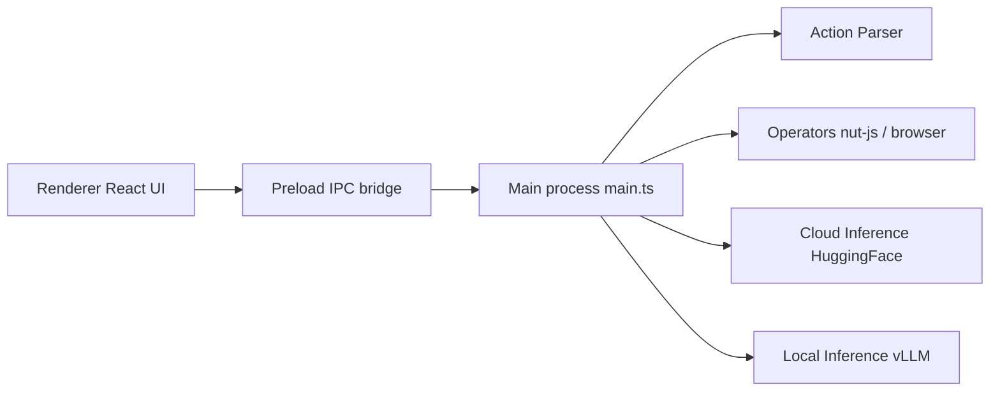

# bytedance/UI-TARS-desktop

> Multimodal agent stack: Agent TARS (CLI and Web) and a vision-driven desktop app.

## The problem
Automating a graphical interface or a browser requires an agent that understands the screen, not just text.

## What it actually does
Two projects. Agent TARS: CLI with a Web interface, browser driven by GUI, DOM or hybrid, event stream and mounting of MCP servers. UI-TARS Desktop: Electron application that controls mouse and keyboard based on screenshots, with the UI-TARS and Seed-1.5-VL models. The code is a monorepo: main process, React renderer, preload, packages (action parser, operators, SDK).

## How it is wired


## Trying it
```bash
npx @agent-tars/cli@latest
npm install @agent-tars/cli@latest -g
agent-tars --provider anthropic --model claude-3-7-sonnet-latest --apiKey your-api-key
```

## Cost and gotchas
Node.js ≥ 22 required. API key from a model provider at your expense; the examples cite Volcengine and Anthropic. Mouse and keyboard control gives broad access to the machine.

## What it is not
Not a deterministic UI testing tool: the agent decides from screenshots. The desktop section says "fully local processing", which depends on how the chosen model is deployed.

## Alternatives
Midscene is cited for in-browser use.

## For you
Worth watching: useful for exploring visual automation, but desktop access and the dependency on a vision model call for a sandbox.
