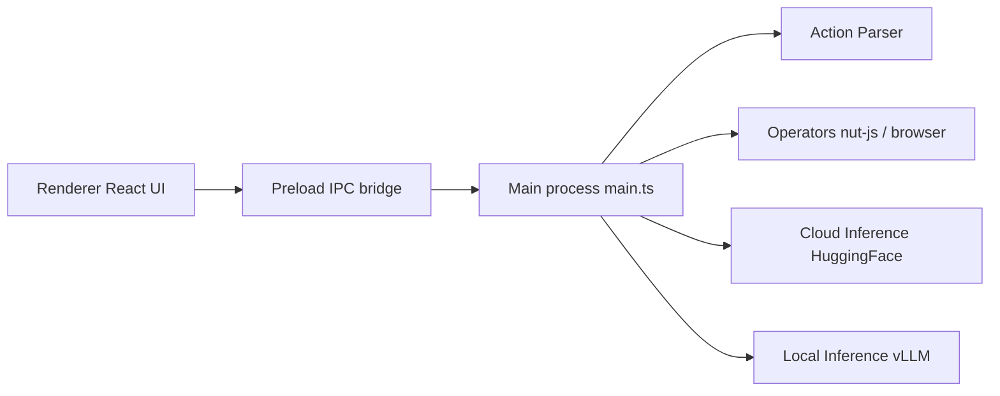

# bytedance/UI-TARS-desktop

> Pile d'agents multimodaux : Agent TARS (CLI et Web) et appli de bureau pilotée par vision.

## Le problème
Automatiser une interface graphique ou un navigateur demande un agent qui comprend l'écran, pas seulement du texte.

## Ce que ça fait vraiment
Deux projets. Agent TARS : CLI avec interface Web, navigateur piloté par GUI, DOM ou hybride, flux d'événements et montage de serveurs MCP. UI-TARS Desktop : application Electron qui contrôle souris et clavier d'après des captures d'écran, avec les modèles UI-TARS et Seed-1.5-VL. Le code est un monorepo : processus principal, renderer React, preload, packages (analyseur d'actions, opérateurs, SDK).

## Comment c'est branché


## Essayer
```bash
npx @agent-tars/cli@latest
npm install @agent-tars/cli@latest -g
agent-tars --provider anthropic --model claude-3-7-sonnet-latest --apiKey your-api-key
```

## Coût et pièges
Node.js ≥ 22 requis. Clé d'API d'un fournisseur de modèles à ta charge ; les exemples citent Volcengine et Anthropic. Le contrôle de la souris et du clavier donne un accès large à la machine.

## Ce que ce n'est pas
Pas un outil de test d'interface déterministe : l'agent décide à partir de captures. La section desktop dit « traitement entièrement local », ce qui dépend du déploiement du modèle choisi.

## Alternatives
Midscene est cité pour l'usage dans le navigateur.

## Pour toi
À surveiller : utile pour explorer l'automatisation visuelle, mais l'accès bureau et la dépendance à un modèle vision demandent un bac à sable.

