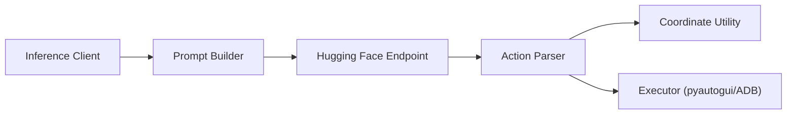

# bytedance/UI-TARS

> Vision-language model that drives graphical interfaces from screenshots.

## The problem
Automating tasks on a desktop, a browser or a phone requires an agent that understands the screen and acts.

## What it actually does
The model receives a screenshot and produces "Thought" and "Action". The `ui-tars` package parses this output and converts it into pyautogui code, with coordinate conversion. Three prompt templates: `COMPUTER_USE`, `MOBILE_USE`, `GROUNDING`. The model is deployed via a Hugging Face endpoint.

## How it is wired


## Trying it
```bash
pip install ui-tars
```
The README then gives a Python example with `parse_action_to_structure_output`.

## Cost and gotchas
The README indicates significant compute resources; the exact GPU size is not given. The best-performing 1.5 model is only offered under research access.

## What it is not
Not a ready-to-use agent: the desktop and browser versions are in other repositories (UI-TARS-desktop, Midscene). The authors flag risks of misuse and hallucinations. Last push on 2026-01-27.

## Alternatives
Midscene.js, cited for web automation; UI-TARS-desktop for the local device.

## For you
Keep an eye on it: a reference for computer-use agents, but a partial building block that requires model deployment.
