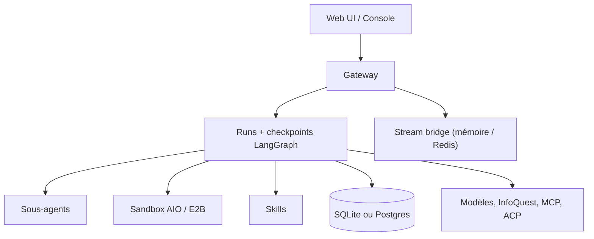

# bytedance/deer-flow

> Agent orchestration harness for managing sub-agents, memory, and sandboxes, with skills extensibility, developed by ByteDance.

## The problem
A single agent working on a long task can quickly exhaust its resources and lacks a secure environment to execute code.

Coordinating multiple agents, with the ability to recover after an incident, requires a comprehensive infrastructure.

## What it actually does
Orchestration of worker agents with configurable limits, persistent memory, and execution sandboxes.
`make setup` configuration assistant that generates `config.yaml` and `.env` files in two minutes.
Models configurable in YAML or through the interface; supported providers with a CLI (Codex, Claude Code OAuth) and agent APIs.
Persistence using SQLite or Postgres, with LangGraph checkpoints for recovery, and SSE (Server-Sent Events) with limited re-reading.

## How it is wired


## Trying it
```bash
git clone https://github.com/bytedance/deer-flow.git
cd deer-flow && make setup
make doctor
make docker-init && make docker-start
```

## Cost and gotchas
The specifications are your responsibility. The recommended configuration for a server is: 8 vCPU, 16 GB of RAM, and 40 GB of storage.
A configuration of `2 vCPU / 4 GB` is explicitly stated to be insufficient, even in a local evaluation.

## What it is not
Not a finished product: version 2.0 is a complete rewrite, with no shared code with version 1.x.
Not easy to operate with multiple workers – it requires Postgres, Redis, heartbeat monitoring, and an event store in a database.
The README includes several services from Volcengine/BytePlus; the InfoQuest integration is custom-built.

## Alternatives
- `OpenHands/OpenHands`: This refers to a similar concept of an agent server, with a multi-backend console.
- `langflow-ai/langflow`: Visual orchestration, much lighter to deploy.

## For you
This is the most comprehensive harness of the lot, and also the heaviest. It requires careful planning and should not be used impulsively.
