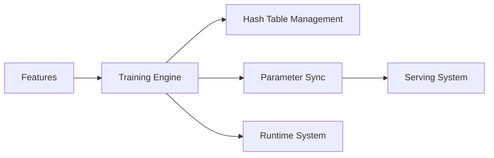

# bytedance/monolith

> ByteDance framework for large-scale recommendation model training on TensorFlow, archived.

## The problem
Recommendation systems with a very large number of identifiers suffer from collisions in embedding tables and react slowly to trends.

## What it actually does
According to the README: collisionless embedding tables (unique representation per identifier) and real-time training, on top of TensorFlow, in batch or streaming, training and serving. The GitDiagram schema mentions parameter servers and distributed workers, but no component is readable in it. A `MonolithModel` API and a distributed asynchronous training tutorial are mentioned.

## How it is wired

(Diagram provided with no readable components: nodes taken from the textual explanation.)

## Trying it
```bash
pip install -U --user pip numpy wheel packaging requests opt_einsum
pip install -U --user keras_preprocessing --no-deps
bazel run //monolith/native_training:demo --output_filter=IGNORE_LOGS
```

## Cost and gotchas
Linux-only build with Bazel 3.1.0, an old version to install by hand. Archived repository: no more fixes.

## What it is not
Not a maintained or portable library: archived, license not identified by GitHub, documentation limited to a demo.

## Alternatives
No alternative named in the README.

## For you
Ignore: archived repository, license to verify and a dated Bazel/TensorFlow chain; at best interesting for reading the idea of collisionless embeddings, not for building on.
